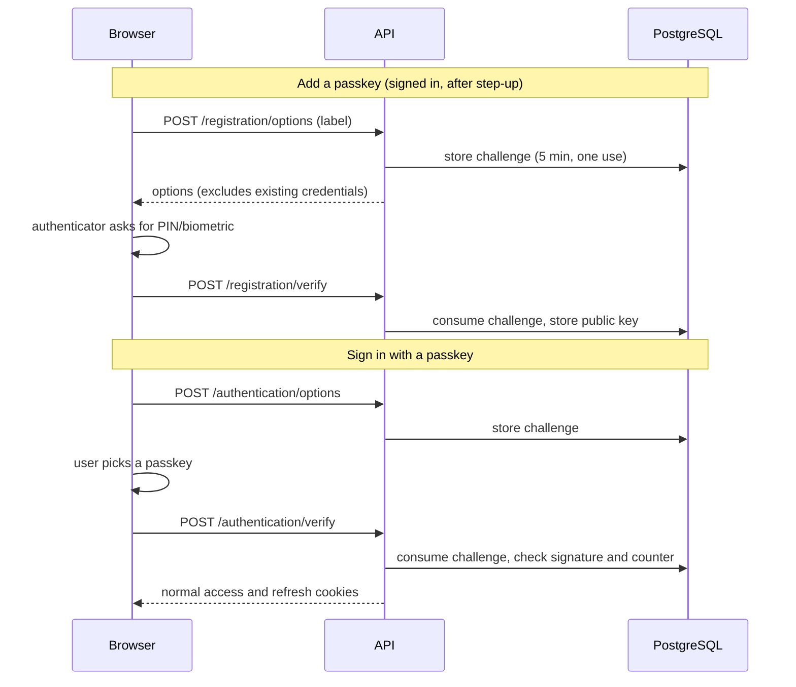
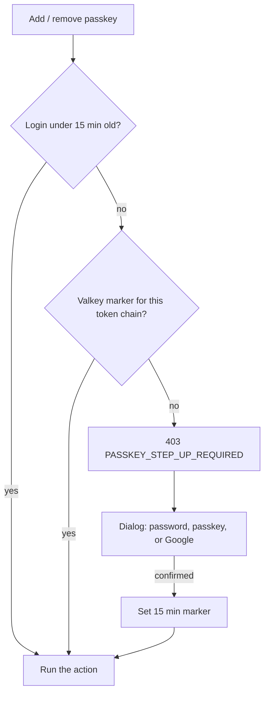
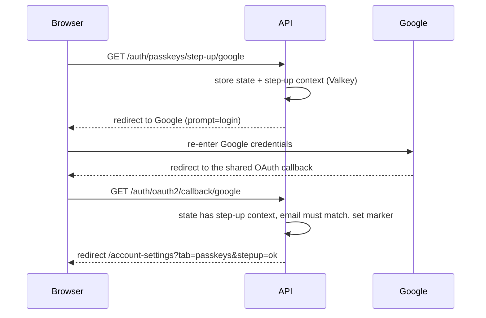

# Passkeys
---

Passkeys are an optional sign-in method for an existing, verified account. Users still create
accounts and recover access through the existing password or Google sign-in flows. A passkey can
be added, renamed, or removed from **Account Settings → Passkeys**. MysticAuth allows up to ten
credentials per account; the displayed device label is user-provided because browsers do not give
the relying party a dependable device name.

This is a discoverable-credential flow: users can choose **Sign in with a passkey** without first
typing their email. Registration requires user verification (such as a device PIN or biometric),
and existing sign-in credentials are never changed when a passkey is added or removed.

## Components

| File | Role |
|---|---|
| `backend/mystic_auth/auth/passkeys/passkey_service.py` | WebAuthn option generation, challenge storage and single use, response verification, credential list/rename/remove |
| `backend/mystic_auth/auth/passkeys/passkey_handler.py` | Registration, passkey sign-in (lockout, audit, cookies, session), list/rename/remove/bulk remove |
| `backend/mystic_auth/auth/passkeys/passkey_step_up_handler.py` | The "confirm it's you" check: 15-minute window, password and passkey confirmation, lockout |
| `backend/mystic_auth/auth/passkeys/passkey_google_step_up_handler.py` | Google re-authentication for accounts with no password |
| `backend/mystic_auth/auth/passkeys/passkey_origin.py` | Exact-match check of the browser's `Origin` header against `WEBAUTHN_ORIGINS` |
| `backend/mystic_auth/auth/passkeys/passkey_model.py`, `passkey_schema.py` | Tables (credentials, challenges) and request bodies |
| `backend/mystic_auth/api/auth_routes/passkey_routes.py` | All `/auth/passkeys/*` routes, mounted by `auth_routes.py` |
| `backend/mystic_auth/auth/security/rate_limiting/account_keys.py` | Rate-limit account key taken from the access-token cookie |
| `frontend/src/mystic_auth/auth/login/usePasskeyLoginMutation.ts` | Passkey sign-in and normal profile/session initialization |
| `frontend/src/mystic_auth/passkeys/` | Passkeys tab: `PasskeysCard`, `AddPasskeyForm`, `PasskeysBulkToolbar`, `passkeysTable`, `PasskeyStepUpDialog`, `usePasskeyManagement` (server calls), `useStepUpReturnToast` (Google return) |

The backend uses Duo Labs' `webauthn` package for verification. The React app uses
`@simplewebauthn/browser` to convert JSON options and browser credential responses; it does not
decide whether a credential is valid. The private key stays with the authenticator. PostgreSQL
stores the credential ID, public key, signature counter, transports, user label, and use dates.

## Flows

Registration and sign-in. The challenge is a random value the server stores first and the
authenticator signs, which proves the response belongs to this ceremony.

Step-up. A fresh login counts, otherwise the API answers `403 PASSKEY_STEP_UP_REQUIRED` and the
blocked action is retried after the user confirms.

Google confirmation (accounts with no password):

## Security behavior

- Registration and authentication challenges are random, stored in PostgreSQL, bound to their
  ceremony and (for registration) account, expire after five minutes, and are consumed once under
  a row lock. Expired rows are swept hourly by a scheduled worker task. The unauthenticated
  options endpoint only inserts one row and is limited to 20 requests per minute per IP. A failed
  verification still consumes its challenge, so the user restarts the ceremony.
- The verifier checks the challenge, relying-party ID, exact allowed origin, signature, and user
  verification. Unexpected or missing origins fail closed. Credential IDs are unique across the
  deployment; a credential cannot be attached to a second account.
- Adding or removing a passkey needs a recent identity check ("step-up", like GitHub's sudo
  mode). A login in the last 15 minutes counts. Otherwise the API answers `403` with code
  `PASSKEY_STEP_UP_REQUIRED` and the Passkeys tab shows a dialog: confirm with the account
  password (`POST /auth/passkeys/step-up/password`) or an existing passkey
  (`POST /auth/passkeys/step-up/passkey`). Success stores a marker in Valkey for the current token
  chain for 15 minutes and the blocked action is retried. The user is never signed out. The
  marker dies with the session, and if Valkey is unavailable the check fails closed.
- Failed confirmations share the per-account and source-IP lockout, `Retry-After`, and alert path
  used by password login. A passkey confirmation must belong to the signed-in account.
- Accounts without a password can confirm with Google. The dialog's **Continue with Google**
  button navigates to `GET /auth/passkeys/step-up/google`, which sends the user to Google with
  `prompt=login` so Google asks again even if its own session is warm. The shared OAuth callback
  recognises the stored step-up context, requires a verified Google email equal to the account's
  email, unlocks that exact token chain for 15 minutes, and returns to
  `/account-settings?tab=passkeys&stepup=ok` (or `stepup=<error code>`). It never logs in, creates,
  or links an account, and the state is single use (cancelling also consumes it). The blocked action
  is not replayed after the redirect; the user repeats it and it now succeeds.
- Listing and renaming are account-scoped and do not need step-up because they cannot grant
  access. Removal only deletes the caller's own credential. Management requests are rate limited
  and audited, including `passkey_step_up_success` and `passkey_step_up_failure`.
- Audit events are `passkey_registered`, `passkey_registration_failure`, `passkey_renamed`,
  `passkey_removed`, `passkey_login_success`/`_failure`, and `passkey_step_up_success`/`_failure`.
  They appear in **Security Log** under the Passkeys group. Passkey sign-ins also count in the
  Sign-in activity chart.
- Rate limits and lockouts show in the **Rate Limits** dashboard under `passkey_login`,
  `passkey_management`, `passkey_step_up`, `passkey_step_up_google`, and `login_lock`. Failed
  passkey sign-ins are counted per source IP (`login_lock:ip:<keyed digest>`); failed step-up
  confirmations per account and IP (`login_lock:account_ip:<keyed digest>`). Raw IPs and emails
  are never stored in the key.
- Repeated failed passkey sign-ins from one source IP trigger the same temporary lockout (HTTP 429
  with `Retry-After`) and security alert used by password login. Success clears the counter.
- The browser-reported `transports` list is filtered to known WebAuthn transport names before it
  is stored.
- Passkeys are an independent credential. A password reset or "sign out everywhere" revokes
  sessions but does not delete passkeys, so after an account compromise a user should review
  **Account Settings → Passkeys**. Registering one needs the step-up check above, and every add, rename,
  and removal is audited.
- A passkey login creates the same access/refresh cookie pair, token chain, session row, last-login
  timestamp, and audit event as password and Google sign-in. Inactive or unverified accounts are
  rejected.

## Known limits

- A passkey is bound to the relying-party ID, so moving to a new domain, or using a tunnel whose hostname changes (Cloudflare Quick Tunnel), makes existing passkeys unusable on the new host. Users sign in with their password or Google and add new passkeys. This is how WebAuthn resists phishing and cannot be made portable. Choose the production domain before users register passkeys.
- Passkeys are independent of the password on purpose, so a password reset or "sign out everywhere" leaves them in place. The account holder is emailed on every add and removal, and an operator holding `users:manage_passkeys` can list and revoke another user's passkeys.
- Automated tests use Chromium's virtual authenticator. Passkey registration and sign-in were also verified by hand on a laptop and a phone through the ngrok stack. Hardware security keys were not tried, which is accepted because few users rely on them. The Google confirmation path is covered by integration tests with a mocked Google.

## Relying-party configuration and domains

The frontend's hostname is part of passkey identity. Keep it stable after users enroll credentials.
Changing the relying-party ID means credentials registered under the previous ID will not work
under the new one; moving from a temporary demo hostname to a VPS domain requires users to add new
passkeys after moving.

| Setting | Meaning |
|---|---|
| `WEBAUTHN_RP_ID` | Hostname only, with no scheme, path, or port. Blank derives it from `FRONTEND_BASE_URL`. |
| `WEBAUTHN_ORIGINS` | Comma-separated exact browser origins. Blank uses `FRONTEND_BASE_URL`. Each hostname must equal or be a subdomain of the RP ID. |
| `WEBAUTHN_RP_NAME` | Product name shown by authenticators. Blank uses `APP_NAME`. |

All origins must use HTTPS except `localhost` development origins. The browser API requires a
secure context; localhost is the development exception. Use one stable HTTPS hostname in a real
deployment and keep the same RP ID across restarts. These values are present in each
`env/mystic_auth/.env.*.example` and are read by the backend at runtime.

Cloudflare Quick Tunnel is still suitable for a short demo. Set `FRONTEND_BASE_URL` to the current
Quick Tunnel URL (or set the two WebAuthn settings explicitly) for passkey registration to work.
When Quick Tunnel issues a different hostname, credentials from the previous hostname will not
work there. The stable ngrok, Cloudflare Named Tunnel, and Tailscale Funnel modes avoid this
restart limitation. See [Local-Prod Deployment](../deployment/local-prod/README.md#which-tunnel-do-i-want).

For multiple frontend origins, explicitly list only origins whose hostnames are within the same
RP ID. Do not use a wildcard origin rule. If the frontend and API use separate origins, configure
the exact frontend origin, since that's the origin browsers include in WebAuthn client data.

## API flow

1. A signed-in user requests registration options with a chosen label. The server excludes their
   already-registered credential IDs and stores the challenge.
2. The browser calls `startRegistration()` and posts its response with the label. The server
   consumes the challenge, verifies the response, and stores only the public credential material.
3. For login, the browser requests discoverable authentication options, calls
   `startAuthentication()`, and posts the assertion. The server resolves the account by credential
   ID, verifies the signature/counter/user handle and account state, then issues the normal session.
4. `GET /auth/passkeys` lists labels and timestamps. `PATCH /auth/passkeys/{id}` renames one;
   `DELETE /auth/passkeys/{id}` removes one. `POST /auth/passkeys/bulk-remove` removes several
   (`{"ids": [..]}`, 1 to 10) or every passkey (`{"all": true}`) in one request, behind the same
   step-up check, scoped to the caller's own credentials, and recorded as a single
   `passkey_removed` audit event (metadata `count` and `scope`: `single`, `selected`, or `all`). The Passkeys tab lists credentials in a table
   with row selection, **Remove selected**, and **Remove all**, like the Active Sessions card. A
   passkey's name is edited in place and saves on Enter or when the field loses focus (Escape
   cancels), so there is no separate Rename button.

5. **Notices.** The account owner is emailed whenever a passkey is added or removed, so a passkey
   added to a hijacked account is not silent. The email is best effort and never fails the change.
6. **Incident response.** A caller holding `users:manage_passkeys` can list another user's passkeys
   (`GET /users/{email}/passkeys`, metadata only) and revoke one or all
   (`DELETE /users/{email}/passkeys[/{id}]`). It can never add a passkey or read credential
   material. It is refused for the caller's own account (use the step-up flow above), for the system
   account, and for a target holding the admin role unless the caller also holds
   `users:manage_privileged` (the role is only target metadata, the decision is still the permission).
   Each revoke is a `passkey_removed` audit event whose metadata includes `removed_by`, and the user
   is emailed. The action is seeded into `system_superuser` by migration `5a7c9e1b3d2f`. In the UI it is
   the **Manage passkeys** item in a user's row menu on the Users page, offered only to holders of the
   permission and never on your own row.

The schema is added by Alembic revision `9f1a2c3d4e5f`. Normal deployments apply it through the
existing migration service before the backend starts.

## See also

- [Authentication Flows](overview.md)
- [Deployment Environment](../deployment/environment.md)
- [Database Design](../database/design.md)
- [WebAuthn Level 3](https://www.w3.org/TR/webauthn-3/)
