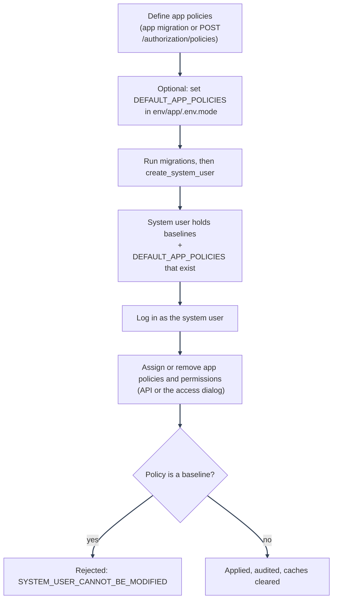

# App Policies on the System User

---

For a downstream app owner: how to give the system account your app's own access. Read [Behavior and Prompts](creation-and-promotion-behavior.md) first for how the account is created.

---

## What is protected and what is yours

| Item on the system user | Can the API change it? |
|---|---|
| `self_service`, `user_management`, `system_superuser` | No. Single and bulk policy routes reject them with `SYSTEM_USER_CANNOT_BE_MODIFIED`. |
| Policies named in `DEFAULT_APP_POLICIES` | Yes. They are only a starting set, assigned when the script creates or promotes the account. |
| Any other app policy | Yes, through the single and bulk policy routes. |
| Direct permissions | Yes, in both directions. Revoking one deletes only that grant, so it never removes access a baseline policy provides (there is no deny). |
| Role, profile, password | No. |

The usual rule still applies: the caller must hold every action the policy or permission grants. A `system_superuser` holder may grant app-owned actions (anything outside MysticAuth's built-in list), so the system user can give itself any app policy once it exists.

---

## Flow

---

## Steps

1. Define the policies before the script runs. An app-owned Alembic migration is repeatable. A policy named in `DEFAULT_APP_POLICIES` that does not exist yet is logged and skipped, and the script still finishes.
2. Run `create_system_user` (see [System Superuser](README.md)).
3. Anything added later is done as the system user through the API or the Users page access dialog.

Changing `DEFAULT_APP_POLICIES` later only affects accounts verified afterward, so assign the new policy to the existing system user by hand. Re-running the script on an existing system user restores only the baselines.

---

See [Writing and Testing Policies](../../authorization/writing-testing-policies.md) for `DEFAULT_APP_POLICIES` itself.

---
