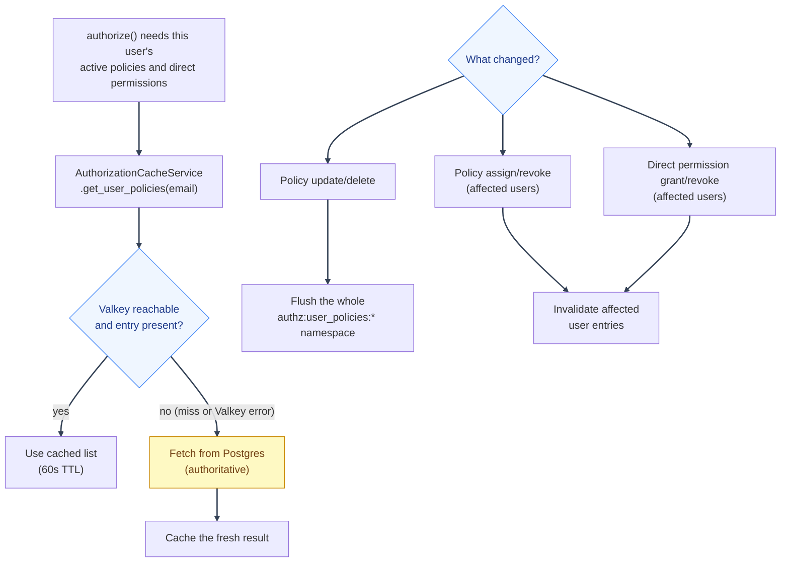

# Troubleshooting: Logging and Valkey Cache

---

## Logging and debugging

- All authorization-relevant logging goes through `backend/mystic_auth/logging/logging_config.py`'s `get_logger(__name__)`: structured, module-scoped loggers.
- A failure to queue a single decision's audit row (`authorization_audit_logger.py`) or to write a batch's rows (`AuthorizationService.authorize_batch`) is caught and logged as a `warning`, never re-raised: an audit logging failure must never break the actual authorization decision it's describing. If you suspect audit entries are silently failing to write, check application logs for `"Failed to queue authorization audit log entry"` and `"Failed to write batch authorization audit log entry"`.
- `AuthorizationCacheService` similarly logs (and swallows) every Valkey failure with a specific prefix per operation (`"Authorization cache read failed"`, `"...write failed"`, `"...invalidation failed"`, `"...namespace flush failed"`): grep for these to confirm whether a perceived staleness issue is actually a cache failure being silently absorbed.
- The backend container's own request logs (`docker compose logs backend`) show every HTTP request/response; for a specific authorization decision, correlate by timestamp against the audit log's `created_at`.

---

## Valkey cache management

`authorization/caching/authorization_cache_service.py` is the **only** place authorization code talks to Valkey. It caches two per-user results for 60 seconds: active assigned policies (`authz:user_policies:<email-key-id>`) and active direct permissions (`authz:user_permissions:<email-key-id>`). The key suffix is an HMAC from `email_key_id(email)`, not the raw address. Policy edits flush the policy namespace because they can affect any holder; policy assignment changes invalidate affected users, while direct-permission changes invalidate only the affected users. It deliberately does **not** cache policy-lookup-by-name or final evaluation decisions: see the module's docstring for the correctness reasons (a cached, session-detached `Policy` object fed into an update/delete would break SQLAlchemy's identity map; caching a final decision could risk serving a stale answer for genuinely time/context-sensitive conditions).



A Valkey error is one specific case of "no entry present" above, not a separate path: it falls straight through to the same Postgres fetch, so a fully unreachable Valkey degrades performance (every check re-fetches from Postgres) rather than correctness or availability.

**Invalidation happens automatically:**
- Policy `update`/`delete` flushes the *entire* `authz:user_policies:*`
  namespace. A policy definition change can affect every holder, and there is
  no cheap reverse index.
- Policy assign/revoke via the management API invalidates only that user's cache
  entry.

**If you suspect stale cached permissions:**

```bash
docker compose -f docker/mystic_auth/compose/docker-compose.dev.yml -f docker/app/compose/docker-compose.dev.yml --env-file env/mystic_auth/.env.dev --env-file env/app/.env.dev exec valkey valkey-cli KEYS "authz:user_policies:*"
docker compose -f docker/mystic_auth/compose/docker-compose.dev.yml -f docker/app/compose/docker-compose.dev.yml --env-file env/mystic_auth/.env.dev --env-file env/app/.env.dev exec backend python -m mystic_auth.scripts.invalidate_authorization_cache --email someone@example.com
docker compose -f docker/mystic_auth/compose/docker-compose.dev.yml -f docker/app/compose/docker-compose.dev.yml --env-file env/mystic_auth/.env.dev --env-file env/app/.env.dev exec backend python -m mystic_auth.scripts.invalidate_authorization_cache --all-policies
```

The first command lists only hashed identifiers. The second invalidates one
account's policy and direct-permission entries by email through the supported
CLI; do not pass an email address to `valkey-cli DEL`, because it is not the
stored key suffix. The third clears every cached policy list after an
out-of-band policy-definition change.

**This is server-side correctness only.** A browser tab that already has a permission-gated page open doesn't re-request anything just because the cache above got invalidated. It needs its own signal to go check. See [Architecture: Real-time push](../architecture/real-time-push.md#real-time-push) for the SSE nudge that closes that gap; if a tab still shows stale permissions for more than a few seconds after a grant/revoke/update/delete, check that flow (and the browser's Network tab for a live `GET /auth/session-events` connection) before assuming it's this Valkey cache.

**Fail-closed behavior:** every cache method catches all Valkey errors and returns a cache-miss sentinel rather than raising. "Fail closed" here means *the cache is never trusted over the database*: any Valkey error transparently falls through to the authoritative DB query, not "deny every authorization request when Valkey is down." A fully unreachable Valkey degrades performance (every check re-fetches from Postgres), never correctness or availability.

**Verifying it end-to-end** (useful after any change to the caching layer):

```bash
scripts/mystic_auth/docker/dev/backend-exec.sh python -c "
import asyncio
from backend.mystic_auth.authorization.caching.authorization_cache_service import authorization_cache_service
from backend.mystic_auth.authorization.models.policy_model import Policy

async def main():
    p = Policy(name='x', actions=['a'], resource_type='r', conditions=None, is_active=True)
    await authorization_cache_service.set_user_policies('test@example.com', [p])
    print(await authorization_cache_service.get_user_policies('test@example.com'))
    await authorization_cache_service.invalidate_user_policies('test@example.com')
    print(await authorization_cache_service.get_user_policies('test@example.com'))

asyncio.run(main())
"
```

---

See [Troubleshooting](README.md) for the other pages.

---
