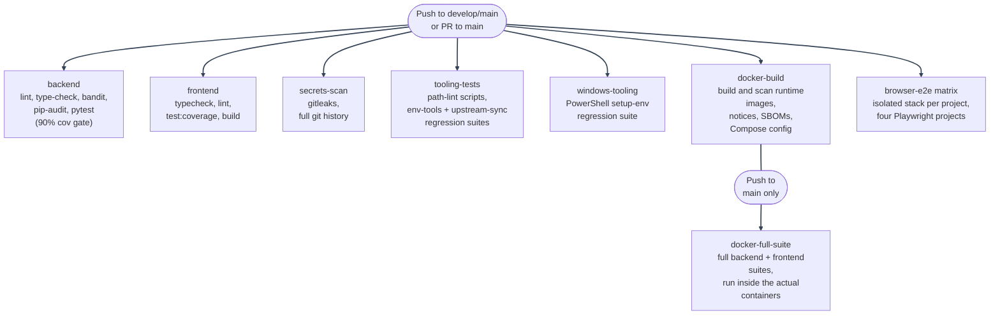

# CI/CD Overview
---

*New to a term here? See the [Infrastructure Glossary](../glossary/infrastructure.md).*

---

## Workflow

`.github/workflows/ci.yml` triggers on pushes to `develop` or `main`, and on
pull requests targeting `main`. It declares top-level `permissions: contents: read` because none of the
jobs push commits, comment on PRs, or need write access. A compromised action
dependency in this workflow can only read the checkout.

There are seven jobs on every push and pull request, plus the Docker
full-suite job that runs only on a push to `main`.

For local parity, run the Linux-equivalent jobs from the repository's normal
development shell, run the `windows-tooling` regression through Windows
PowerShell, and use a disposable Compose project for container checks. WSL2
can run Linux and Docker checks; invoke `powershell.exe` from WSL2 for the
Windows PowerShell regression. GitHub-hosted artifact uploads and runner
behavior still require GitHub Actions. Record any exact local blocker rather
than calling the entire workflow passed.

Ownership-specific CI commands live under `ci/mystic_auth/` and `ci/app/`.
The workflow remains shared because GitHub Actions does not import arbitrary
YAML from a root `ci/` directory. The scripts split native backend, frontend,
tooling, and backup commands; Docker, Compose, browser, and container-suite
checks remain in the workflow because they exercise the assembled application.

---

---

### `backend`: Backend (unit + integration)

- Spins up Postgres 18 and Valkey 9.1.2-alpine as GitHub Actions service containers. Compose
  remains the source of truth for local development, but service containers are
  a lower-overhead CI equivalent for the backend job.
- Provides all required settings as job-level environment variables with
  clearly fake CI-only values because CI has no checked-in `env/mystic_auth/.env.dev`. `APP_NAME`
  is set to `MysticAuth` only because `Settings` requires a value. It is a test
  placeholder, not branding that a downstream project must keep in sync.
- Installs `backend/requirements.txt` and `backend/requirements-dev.txt`, then
  runs `pip-audit -r backend/requirements.txt`.
- Runs MysticAuth and app `ruff`, `mypy`, and `bandit -c pyproject.toml` checks
  as separate steps through `ci/mystic_auth/backend.sh` and
  `ci/app/backend.sh`, so the failing ownership area is obvious in the
  Actions UI.
- Runs `alembic upgrade head`, then `alembic check`. The check fails if models
  drift from what the migrations create.
- Runs app unit tests, then MysticAuth unit, integration, and security suites.
  The integration and security steps use `--cov-append`, so the final 90% gate
  checks cumulative coverage across all four suites. `pytest.ini` intentionally
  does not set `--cov-fail-under` because that would break partial local runs. See
  [Testing Overview](../testing/overview.md).
- The MysticAuth integration step is the blocking owner for audit-log behavior,
  including protected-action entries such as `users:list_all`; failures are
  reported separately from app-owned backend unit failures.
- Runs `pytest tests/backend/mystic_auth/performance` as a non-blocking step
  because timing thresholds can be noisy on shared GitHub-hosted runners.

---

### `frontend`: Frontend (typecheck + lint + test + build)

- Node is pinned to `22.22.2`, the version required by the locked frontend
  toolchain.
- Runs `npm ci --legacy-peer-deps`, `npm audit --audit-level=high`,
  `npm run typecheck`, `npm run lint`, `npm run test:coverage`, and
  `npm run build` as separate steps. `test:coverage` is used instead of plain
  `test` so `vitest.config.ts` coverage thresholds are enforced.

---

### `secrets-scan`: Secrets scan (gitleaks and Trivy)

- Checks out full git history with `fetch-depth: 0` and runs
  [gitleaks](https://github.com/gitleaks/gitleaks). This catches secrets that
  were committed and later removed from the working tree.
- Runs Trivy's JWT-aware filesystem secret scanner against the checkout. This
  complements Gitleaks by looking for secret patterns in the current source
  tree, including JWT-shaped values.

---

### `tooling-tests`: Tooling regression tests (paths, env, sync, Compose validation)

- Runs `ci/mystic_auth/tooling.sh`, which invokes the template tooling checks,
  including `check-script-paths.sh` and `check-split-paths.sh`: no live stack
  needed, just static path resolution against the checked-out tree. The path
  checker also validates `ci/` references. Added after a stale path in `quickstart.sh`
  broke the README's own first command; together they've since caught 30+
  further stale-path instances the same way.
- Runs `check-image-digests.sh` through the MysticAuth tooling entrypoint:
  asserts
  every `@sha256:...`-pinned image in `docker/{mystic_auth,app}/compose/*.yml`
  is a syntactically valid 64-character digest. Added after a 2026-10-05
  security audit found a one-character-short digest on the `geoipupdate`
  image, copy-pasted into all four production-shaped compose files, that
  failed `docker pull` outright on a clean host (`docker compose config`
  does not validate digest length, only that the field parses as a string).
- Runs `check-log-rotation.sh`, `check-ci-action-pinning.sh`, and
  `check-readonly-rootfs.sh` to enforce bounded Compose logs, immutable CI
  action references, and read-only root filesystems for production-shaped
  services. These are static checks; they do not replace a live container
  smoke test.
- Runs the env-tools regression suite
  (`tests/scripts/mystic_auth/env-tools/test-env-tooling.sh`), the
  upstream-sync regression suite
  (`tests/scripts/mystic_auth/upstream-sync/test-sync-upstream.sh`), backup
  freshness and encryption checks, backup network isolation, and host backend
  port derivation. The env and sync suites use throwaway copies; no test
  rewrites this repo's real env files.

---

### `docker-build`: Docker image build verification

- Validates all five paired Compose modes using disposable copies of the
  example env files and a harmless backup command for interpolation checks.
- Builds the backend runtime, frontend production, `db-backup`, ngrok, and
  Cloudflare Tunnel images. It checks shipped dependency notices and image
  contents, scans each image for unfixed critical/high vulnerabilities, and
  generates SPDX JSON SBOMs from those exact images. The pinned ngrok binary currently has
  time-limited, image-scoped exceptions for vendored Go findings until its
  publisher ships a rebuilt release; see
  [`trivy-ngrok.ignore.yaml`](../../../ci/mystic_auth/trivy-ngrok.ignore.yaml).
  GitHub uploads the SBOMs with a commit and image-ID manifest; a local run
  can perform the builds and scans but cannot exercise artifact upload.
- Checks that the production frontend image serves its dependency notice
  directory. The standalone nginx smoke supplies a loopback `backend` host
  alias so its production proxy configuration can be parsed without joining
  the app network.
- Verifies `/app/logs` exists but is empty in the backend image. This catches
  host-side logs or other local data copied into an image.
- Does not boot the dev stack, run browser E2E, push images, or deploy. Those
  checks live in separate jobs or outside this workflow's scope.

---

### `browser-e2e`: Browser E2E matrix

- Runs four independent jobs: Chromium desktop, Chromium mobile, Firefox
  desktop, and WebKit desktop. Each job installs its browser and boots an
  isolated dev Compose stack with `ci/mystic_auth/frontend-e2e-stack.sh`.
- Seeds disposable PBAC permission-matrix accounts, then checks backend
  readiness, frontend availability, and response bodies before Playwright.
- Stops the Compose dev frontend after its smoke check so the Playwright
  `PLAYWRIGHT_USE_PREVIEW=1` web server can serve the production build on port
  5173 instead of silently reusing Vite.
- Runs the matching MysticAuth Playwright project with two workers, except
  WebKit with one. The app suite runs once in Chromium desktop and covers all
  configured app projects. The real-account matrix runs only there; responsive
  timing runs in desktop and mobile Chromium.
- Chromium desktop also runs the encrypted backup round-trip and restore
  drill. Other projects skip these database checks.
- Uses `PLAYWRIGHT_USE_PREVIEW=1` to serve the production frontend bundle
  during browser runs. Browser traces and Compose logs are retained or shown
  when a job fails. Each job tears down its Compose volumes and removes only
  env files it created.
- Does not run the opt-in live-deployment smoke test, which needs a separate
  deployment and its own target configuration.

---

### `docker-full-suite`: Full test suite via Docker (main only)

- Gated to `if: github.event_name == 'push' && github.ref == 'refs/heads/main'`.
  It does not run on pull requests.
- Boots the backend stack with the same `BUGSINK_SUPERUSER_EMAIL` override as
  `docker-build`, then runs the same unit, integration, and security tiers
  inside the running backend container. `--user root` is required because
  coverage output writes to `/repo`, the whole-repo bind mount. Native Linux
  does not let the container's non-root `app` user write there. See
  [Docker Overview: running a one-off command inside a container](../docker/dev-workflow.md#running-a-one-off-command-inside-a-container).
- Boots the frontend, then runs its full test suite inside that container the same way.
- Same on-failure `docker compose logs` step as `docker-build`.
- This repeats tests already run natively. The value is running them through the
  deployable image, real container filesystem, installed dependencies, and
  Compose networking. It is `main`-only to avoid doubling PR CI time for the
  same source code.

---

## What's covered

- Backend unit/integration/security suites, against real Postgres/Valkey, gated by a 90% cumulative-coverage threshold; performance tests run too, non-blocking.
- Backend lint (ruff), type-checking (mypy), and security scanning (bandit): all configured in `backend/pyproject.toml`.
- A model/migration drift check (`alembic check`): fails if a SQLAlchemy model's columns or indexes don't match what the checked-in migrations actually produce.
- Full frontend type-check, lint, test (with coverage thresholds enforced), and production build.
- Four Playwright browser projects run in isolated dev Compose stacks, including a WCAG 2.1 AA accessibility scan (`@axe-core/playwright`) across every major page.
- A backup restore drill: dumps the configured app database and Bugsink database, authenticates and restores each into a disposable scratch database, and checks the application schema plus populated database table names and row counts. The dev stack's empty Bugsink database is verified to restore empty.
- Deterministic backup-freshness and encryption checks, covering missing, stale, empty, plaintext, and incomplete backup artifacts.
- Path-lint scripts (stale `scripts/`/`local-scripts/` path references, stale pre-split `docker`/`env`/`scripts` references) and the env-tools/upstream-sync regression suites, all against throwaway copies, never this repo's own real files.
- All five shipped runtime images build and pass the CI vulnerability policy; the ngrok binary's vendored Go findings use dated exceptions while every other image has the full High/Critical gate. On every PR, the actual dev Compose stack also boots and serves traffic.
- Every built runtime image, including Cloudflare Tunnel, has a validated SPDX JSON SBOM retained as a CI artifact, tied to the commit and local image ID used to generate it.
- On every push to `main`: the entire backend + frontend test suites, re-run a second time inside the real containers rather than a bare runner. Pushes to `develop` run the native validation jobs without this duplicate container pass.
- Dependency vulnerability scanning on every push/PR: `pip-audit` (backend, blocking) and `npm audit --audit-level=high` (frontend, blocking). `.github/dependabot.yml` also schedules weekly digest and dependency update PRs for Docker images, Python packages, npm packages, and GitHub Actions. Updates remain ordinary reviewable PRs and still pass the same CI gates.
- Secret scanning across full git history (`gitleaks`), independent of the backend/frontend jobs.

---

## What's not covered (tracked, not silently missing)

See [Concerns](../concerns/README.md) for the full entries:

- No image push to a registry and no deployment stage: deploying is a manual, documented process (see [Deployment Guide](../deployment/guide.md)), not automated.

This is deliberately left as a documented gap rather than added: extending `ci.yml` with a deploy stage is a workflow change with its own blast radius (new required checks, new secrets, a specific hosting target to assume), and unnecessary cloud-specific tooling doesn't belong in a template repository with no assumed production target.

---

## Local equivalents

Run backend, frontend, tooling, Windows PowerShell, Docker image, and browser
checks locally using [CI local validation](local-validation.md). That page
provides the current commands and explains which GitHub-hosted steps cannot be
reproduced on a workstation.

---
