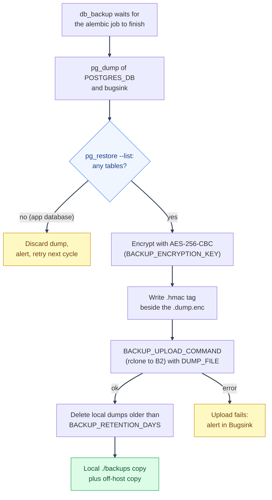

# Database Backups
---

*New to a term here? See the [Infrastructure Glossary](../glossary/infrastructure.md).*

How a scheduled backup flows from the database to off-host storage:



## Backup scripts
---

`scripts/mystic_auth/db/database-backup/database-backup.sh` and `scripts/mystic_auth/db/database-restore/database-restore.sh` wrap Docker Compose, `pg_dump`, and `psql`. Every operator-facing database helper in that directory has matching `.ps1` and `.cmd` entry points; those Windows wrappers delegate to the same tested Bash implementation through Git Bash. Use `.sh` from Bash/WSL/Linux/macOS, `.ps1` from PowerShell, or `.cmd` from Command Prompt with the same arguments. Production-shaped Compose files use a custom pinned Postgres Alpine client image with a checksum-pinned rclone build, OpenSSL, and `curl` installed. Backups are encrypted with AES-256-CBC using PBKDF2 before they are written to `./backups`; the key is never stored beside the backup files. The manual script accepts `BACKUP_DIR=/path/to/writable/dir` when the scheduled sidecar owns the default bind-mounted directory as UID 10001.

The application database name is always taken from `POSTGRES_DB` in the
selected mode's environment files. It is not required to be `mystic_auth`:
downstream applications may use a name such as `example_app_db`. The encrypted
backup round-trip test and restore-drill regression check follow the same
setting and check the configured application database plus the separate
`bugsink` database, so template and downstream runs exercise the same
database-selection contract.

Before keeping a dump, the backup script lists its contents with `pg_restore --list`. A dump of the application database with no tables is discarded and reported as a backup failure, since it means migrations have not run or the wrong database was dumped. The `bugsink` database stays empty until the Bugsink service has started once (CI and fresh dev stacks never start it), so an empty `bugsink` dump only prints a warning.

CBC has no authenticated-encryption mode of its own (`openssl enc -aes-256-gcm` fails outright - the `enc` subcommand doesn't support AEAD ciphers at all), so `scripts/mystic_auth/db/backup-verification/backup-hmac.sh` adds the missing tamper-evidence separately: every `<dump>.dump.enc` gets a detached HMAC-SHA256 tag written alongside it as `<dump>.dump.enc.hmac`, using a MAC key derived from `BACKUP_ENCRYPTION_KEY` (not the raw passphrase itself). `backup-upload.sh` ships the tag off-host with the dump automatically. `database-restore.sh` verifies the tag before decrypting a `.dump.enc` file - a present-but-mismatched tag aborts the restore; a missing tag (a dump made before this existed) only warns, so older backups stay restorable.

Run `scripts/mystic_auth/db/backup-verification/backup-freshness-check.sh` from an external
monitoring scheduler to verify that every required database has a recent,
non-empty dump. It defaults to twice `BACKUP_INTERVAL_HOURS` and checks
`POSTGRES_DB` plus `bugsink`; set `BACKUP_MAX_AGE_HOURS` or pass the directory
and maximum age explicitly when the deployment needs a different policy:

```bash
BACKUP_MAX_AGE_HOURS=30 scripts/mystic_auth/db/backup-verification/backup-freshness-check.sh /backups
```

The check does not claim that an off-host object exists or that a dump can be
restored. Use the restore drill for restoreability and monitor the B2 bucket
itself for off-host freshness.

Run `scripts/mystic_auth/db/backup-verification/check-backup-encryption.sh`
periodically (or from the same external scheduler as the freshness check) to
find plaintext `.dump`/`.sql` files and encrypted dumps with missing, empty, or
malformed HMAC sidecars. This catches backup artifacts left behind during a
format change even though restore itself tolerates a missing HMAC tag on an
older dump (see above). The check defaults to `./backups`; pass a directory
explicitly to check another location. Set `BACKUP_ENCRYPTION_KEY` in the
scheduler's secret environment to also verify each HMAC against the ciphertext.
Without the key, the script checks that each sidecar is well formed but cannot
authenticate it.

```bash
scripts/mystic_auth/db/backup-verification/check-backup-encryption.sh /backups
```

When `BACKUP_ENCRYPTION_KEY` is present in the scheduler's environment, the
same command also verifies each tag against its ciphertext.

```bash
# Dump the dev database and Bugsink database, if enabled
scripts/mystic_auth/db/database-backup/database-backup.sh

# Dump a production-shaped stack
scripts/mystic_auth/db/database-backup/database-backup.sh docker-compose.local-prod-ngrok.yml

# Restore an encrypted dump, with confirmation
scripts/mystic_auth/db/database-restore/database-restore.sh backups/mystic_auth-20260717-120000.dump.enc

# Restore without confirmation
scripts/mystic_auth/db/database-restore/database-restore.sh -y backups/mystic_auth-20260717-120000.dump.enc
```

### Backblaze B2 off-host copies
---

Create a B2 bucket in the Backblaze dashboard with these choices:

1. Give it a globally unique name, such as `mystic-auth-backups-<owner>`.
2. Keep **Files in Bucket** set to **Private**.
3. Enable **Default Encryption**.
4. Enable **Object Lock** for a real backup bucket, then configure a 14-day
   Governance-mode default retention. Object Lock is irreversible, so leave it
   disabled only for a temporary test bucket.

Backblaze's current signup offers 10 GB of free storage without requiring a
billing method. Usage above the free allowance can still incur charges, so
configure B2 caps and alerts.

Create an application key with these choices:

1. The key name is just a label, for example `mystic-auth-backups`.
2. Restrict **Allow access to Bucket(s)** to this backup bucket.
3. Select **Read and Write**.
4. Leave **Allow List All Bucket Names**, **File name prefix**, and **Duration**
   empty.
5. Copy the generated **keyID** and **applicationKey**. The key name is not a
   credential.

### Choosing the interval and cleaning up old objects

Dumps are the only recovery method; there is no point-in-time recovery. After a
total loss you restore the latest dump and lose everything written since it was
taken, so `BACKUP_INTERVAL_HOURS` is your data-loss window. The production
example uses `1` (up to about an hour of loss). The freshness check alarms at
twice the interval by default. Postgres managed services or WAL archiving
(pgBackRest, WAL-G) are the upgrade path if an hour is too long.

Point-in-time recovery (PITR) archives PostgreSQL's write-ahead log continuously so you can restore to a chosen second, such as just before an accidental delete. It is not enabled: it needs a tool such as pgBackRest or WAL-G (or a managed Postgres provider) plus log storage, key management, monitoring and restore drills, and archiving can fill the disk when its destination is down. Hourly dumps were chosen instead because the data changes slowly and the dump, HMAC, upload and restore-drill path is built and tested. Move to PITR when losing an hour of writes is unacceptable.

The B2 bucket, application key and ownership are per-deployment. The freshness script cannot prove an off-host object exists, so the bucket needs its own monitoring and each deployment should repeat the remote restore check. Production-shaped Compose modes refuse to start without `BACKUP_UPLOAD_COMMAND`. The local-prod-ngrok B2 path has been tested by uploading both databases and fully restoring both from the downloaded objects.

Two clean-up rules are independent of each other:

- **Local files:** `BACKUP_RETENTION_DAYS` (14) deletes older dump files from
  `./backups`. Hourly runs keep about 336 dumps per database for that window.
- **B2 objects:** nothing in this repository deletes them. Every dump has a
  unique name, so "keep only the last version" does nothing, and the bucket
  grows without limit. Add a bucket lifecycle rule in the Backblaze dashboard:
  hide files 30 days after upload and delete them 1 day after that. Keep the
  hide period at or above the Object Lock retention (14 days), or deletes will
  be refused. At hourly dumps that is about 720 objects per database in the
  bucket; multiply by your dump size to check it against the free 10 GB.

Keep the application key in the deployment secret store, not in git. In the
environment file used by the production-shaped Compose file, map **keyID** to
`RCLONE_CONFIG_B2_ACCOUNT` and **applicationKey** to
`RCLONE_CONFIG_B2_KEY`:

```dotenv
B2_BUCKET=mystic-auth-production-backups
RCLONE_CONFIG_B2_ACCOUNT=<keyID>
RCLONE_CONFIG_B2_KEY=<applicationKey>
BACKUP_UPLOAD_COMMAND=rclone copyto "$${DUMP_FILE}" "b2:mystic-auth-production-backups/$$(basename "$${DUMP_FILE}")"
# Keep this in a secret manager and separately from ./backups.
BACKUP_ENCRYPTION_KEY=<64-character-secret>
```

The doubled dollar signs are required in a Compose environment file so
Compose passes the variable references through to the backup container. Use
the real bucket name in both `B2_BUCKET` and the `b2:<bucket-name>/...` part of
the command. Do not copy these credentials into an `.example` file.

The scheduled `db_backup` image contains `rclone`; the manual backup command
uses the same hook and therefore needs `rclone` installed on the host. Every
dump is checked with `pg_restore --list` before this command runs. Dump,
verification, and upload failures are reported through the same Sentry
protocol DSN used by the backend. The scheduled service reads the generated
Bugsink DSN from its shared Compose volume. For a manual host-side backup,
export `BACKUP_SENTRY_DSN` if the host cannot read that volume.

After configuring the bucket, verify both directions:

```bash
make restore-drill
scripts/mystic_auth/db/database-backup/database-backup.sh docker-compose.prod.yml
rclone lsjson "b2:${B2_BUCKET}"
rclone copyto "b2:${B2_BUCKET}/<dump-name>.dump.enc.hmac" /tmp/<dump-name>.dump.enc.hmac
rclone copyto "b2:${B2_BUCKET}/<dump-name>.dump.enc" /tmp/<dump-name>.dump.enc
scripts/mystic_auth/db/backup-verification/backup-hmac.sh verify /tmp/<dump-name>.dump.enc "$BACKUP_ENCRYPTION_KEY" && echo "HMAC OK"
openssl enc -d -aes-256-cbc -pbkdf2 -in /tmp/<dump-name>.dump.enc \
  -pass env:BACKUP_ENCRYPTION_KEY | pg_restore --list
```

The restore drill in the repository checks a local dump. A deployment
acceptance check must also download one named B2 object and restore that copy
into a disposable database, then compare its schema and row counts. Periodic
full dumps do not provide point-in-time recovery; use WAL archiving or managed
Postgres if the backup interval is too large for the required RPO.

The restore target is inferred from the dump filename. A `bugsink-*.sql` file restores into the `bugsink` database.

---

## Scheduled backup sidecar
---

`docker-compose.prod.yml` and every `docker-compose.local-prod-*.yml` variant run a `db_backup` service by default.

| Setting | Purpose |
|---|---|
| `BACKUP_INTERVAL_HOURS` | Hours between scheduled dumps. |
| `BACKUP_RETENTION_DAYS` | Local retention window for old dump files. |
| `BACKUP_ENCRYPTION_KEY` | Required secret used to encrypt/decrypt `.dump.enc` files. Store it in a secret manager, not with the backups. |
| `BACKUP_UPLOAD_COMMAND` | Required in production-shaped modes; runs after each verified encrypted dump, with `DUMP_FILE` exported to it, to ship the dump off-host. |
| `./backups` | Host directory where dumps are written. |

The sidecar waits for the `alembic` migration job to finish before its first dump. Every dump is also checked for at least one table: a dump with none (migrations not run yet, wrong database) is deleted, an alert is raised, and the next cycle tries again, so an empty file can never pass as a fresh backup. `database-backup.sh` applies the same check and fails the run.

This is a periodic `pg_dump` loop with encryption, structural verification, and a fail-fast off-host upload requirement in production-shaped modes. `scripts/mystic_auth/db/database-backup/database-backup.sh` (manual/on-demand backups) honors the same encryption and upload settings for parity.

The backup sidecar remains attached to the private `postgres_net` for Postgres
access and also uses a separate non-internal `backup_egress_net` solely for
off-host upload. It has no connection to Valkey's separate internal network.

The scheduled backup image includes `rclone` and uses the B2 environment
variables above. Compose sets `RCLONE_CONFIG=/dev/null` so the non-root backup
process reads its credentials from the environment instead of trying the
root-owned default config path. A host running the manual script needs
`rclone` installed locally.

---

## Backup limitations
---

Operational boundaries:

1. Production-shaped Compose modes fail to start without both `BACKUP_ENCRYPTION_KEY` and `BACKUP_UPLOAD_COMMAND`; this prevents an unprotected deployment from appearing healthy.
2. There is no point-in-time recovery - periodic full dumps only, so worst-case data loss is up to `BACKUP_INTERVAL_HOURS` of writes.
3. Encryption protects backup confidentiality, but losing `BACKUP_ENCRYPTION_KEY` makes recovery impossible. Escrow it separately and test recovery with the restore drill.

### Rotating the backup key

Each encrypted dump and its HMAC sidecar depend on the exact
`BACKUP_ENCRYPTION_KEY` used when they were created. Changing the configured
key affects new backups and future restores; it does not re-encrypt existing
objects. Keep each old key in a separate, access-controlled secret record
until every backup made with it has expired or been deliberately removed.

For a planned rotation, generate a new high-entropy key, update the backup
service and the operator environment used for restores, then recreate the
backup service so it reads the new value. Create fresh dumps for both
`POSTGRES_DB` and `bugsink`, download one copy from the off-host store, verify
its HMAC, and restore it into a disposable database before relying on the new
key. Retain the prior key while any prior backups remain. If a key was
exposed, treat backups made with it as potentially readable to anyone who
obtained both the key and an encrypted dump; rotate the key and remove those
objects when retention policy allows.

Each dump is already verified with `pg_restore --list` immediately after writing, so a corrupt dump is caught before it's trusted, not after a restore is attempted. Beyond that structural check, run [the restore drill](database-restore-and-recovery.md#restore-drill) periodically against production data to confirm the whole pipeline, not just the dump file, works end to end.

---

## Off-host copy without a cloud account
---

If there is no cloud account and no second server, use encrypted removable media as the minimum off-host path.

```bash
# One-time repository setup on mounted removable media
restic -r /mnt/usb-backup/mystic-auth init

# After each backup
restic -r /mnt/usb-backup/mystic-auth backup ./backups
restic -r /mnt/usb-backup/mystic-auth forget --keep-daily 14 --keep-weekly 8 --prune
```

Store the Restic password somewhere separate from the drive, such as a password manager. Disconnect the drive and keep it away from the host when possible.

When a second machine is available, use the same repository model over SFTP:

```bash
restic -r sftp:USER@REMOTE_HOST:/backups/mystic-auth init
restic -r sftp:USER@REMOTE_HOST:/backups/mystic-auth backup ./backups
```

Also keep a recoverable copy of the relevant env file, such as `env/mystic_auth/.env.prod` or `env/mystic_auth/.env.local-prod-ngrok`. A database dump without `SECRET_KEY`, database passwords, and provider secrets is not enough to recover the application.

---
