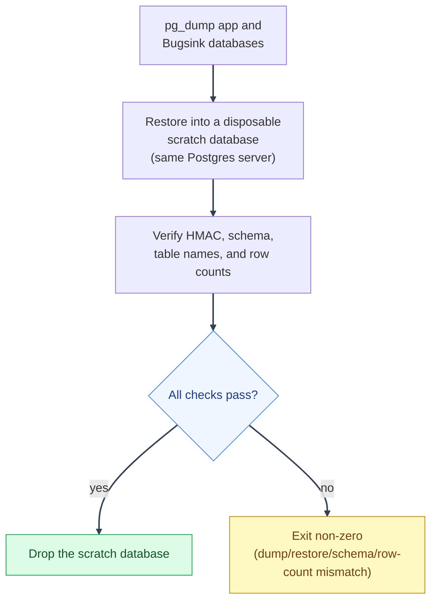

# Database Restore and Recovery
---

*New to a term here? See the [Infrastructure Glossary](../glossary/infrastructure.md).*

## Restore drill
---

A backup nobody has tried to restore is a hope, not a guarantee.
`scripts/mystic_auth/db/database-restore/database-restore-drill.sh` proves both
backed-up databases actually restore: it dumps the configured application
database and `bugsink`, encrypts and authenticates each dump, then restores
each into a disposable scratch database on the same Postgres server. It checks
that the application schema and `users` table exist, compares public table
names and row counts for populated databases, then drops the scratch
databases. The development stack does not start Bugsink, so its separate
database is empty there; the drill verifies that an empty Bugsink dump
restores as empty. A populated deployment Bugsink database follows the same
table and row-count checks as the application database.
Concurrent drills do not collide, and cleanup never drops a pre-existing
database.



Neither real database is overwritten by the drill. It proves both backups
restore without risking the data they protect.

The drill reads both `POSTGRES_DB` and `POSTGRES_USER` from the selected
environment (or the corresponding exported variables). Keep those values
aligned with the database container; the scripts intentionally do not assume
the role is named `postgres`.

```bash
# Prove the dev stack's own database is restorable
scripts/mystic_auth/db/database-restore/database-restore-drill.sh

# Same, against a production-shaped stack
scripts/mystic_auth/db/database-restore/database-restore-drill.sh docker-compose.local-prod-ngrok.yml
```

Exits non-zero on any failure (dump, HMAC, restore, missing schema, or table
parity), so a broken backup path fails loudly here instead of only
being discovered mid-incident. `tests/scripts/mystic_auth/db/test-restore-drill.sh`
runs this as a regression test in CI's `browser-e2e` Chromium desktop job,
against both databases in the dev stack, on every push. It verifies the
application restore, accepts an empty dev Bugsink database, and checks that
both scratch databases are removed after the drill exits.

This is how a real bug was found and fixed while building this drill:
`pg_dump --format=custom --file=-` silently wrote a 0-byte dump on this
image's `pg_dump` build instead of writing to stdout, and `database-backup.sh`
used exactly that pattern. Both scripts now omit `--file` and rely on
stdout redirection instead, which works portably regardless of that
behavior. See the fixed line's own comment in either script for the detail.

---
