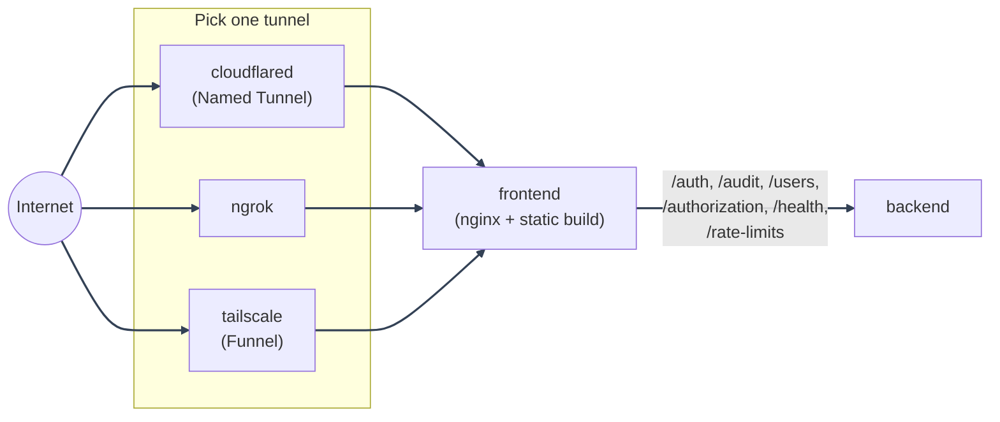

# Local-Prod Deployment

---

Self-hosted production image/runtime shape from your own machine or home
server. The code is baked into images, reload is off, bind mounts are gone,
and a free tunnel exposes the app to the internet without your own public
IP, router port forwarding, or Caddy.

Not sure this is the mode you want? See the
[dev vs. local-prod vs. prod comparison](../guide.md#1-deployment-modes) in the
Deployment Guide.

---

## Which tunnel do I want?

This base repository offers Quick Tunnels, Named Tunnels, ngrok, and Tailscale
as alternatives for exposing the same local-prod app. Each has a walkthrough
below; choose based on whether you need a temporary URL, a stable OAuth origin,
a particular account/domain setup, or tailnet integration.

The helper scripts already pass both the upstream and app Compose/env files.
If you run a manual `docker compose` command copied from a walkthrough, add
the matching `docker/app/compose/docker-compose.<mode>.yml` file after the
`docker/mystic_auth/` file and the matching `env/app/.env.<mode>` file after
the `env/mystic_auth/` file (`.env.dev` is the development exception).

| | Cloudflare Quick Tunnel | Cloudflare Named Tunnel | ngrok | Tailscale Funnel |
|---|---|---|---|---|
| Account needed | None | Free, + your own domain | Free; one assigned static domain | Free |
| URL stability | Random; changes each run | Stable | Stable | Stable |
| Compose file | None; points `cloudflared` at a local HTTP service | `docker-compose.local-prod-cloudflare.yml` | `docker-compose.local-prod-ngrok.yml` | `docker-compose.local-prod-tailscale.yml` |
| Env and token files | None | `.env.local-prod-cloudflare` and `.cloudflare-tunnel-token` | `.env.local-prod-ngrok` | `.env.local-prod-tailscale` |
| Helper script | `cloudflared tunnel --url http://localhost:<port>` | `scripts/mystic_auth/docker/local-prod-cloudflare/local-prod-cloudflare-up.sh` | `scripts/mystic_auth/docker/local-prod-ngrok/local-prod-ngrok-up.sh` | `scripts/mystic_auth/docker/local-prod-tailscale/local-prod-tailscale-up.sh` |
| Walkthrough | [Quick Tunnel](cloudflare-quick-tunnel.md) | [Named Tunnel](cloudflare-named-tunnel.md) | [ngrok Tunnel](ngrok-tunnel.md) | [Tailscale Funnel](tailscale-funnel.md) |

Quick Tunnels are a fast, free option for a temporary demo and do not require
a Cloudflare account or domain. Their random hostname changes on restart, so
OAuth origins and callback URLs must be updated each time. They expose one
local HTTP service, have no uptime guarantee, support at most 200 in-flight
requests, and do not support Server-Sent Events. Anyone with the generated
URL can reach the service. The [Quick Tunnel walkthrough](cloudflare-quick-tunnel.md)
shows both a simple service demo and this app’s local-prod stack.

- **Cloudflare Named Tunnel**: uses a stable hostname under a domain whose DNS
  zone is in your Cloudflare account. It fits repeated demos and OAuth callback
  URLs that should not change.
- **ngrok**: the free plan includes one assigned static development domain,
  which can keep the demo origin and OAuth callback stable across restarts.
  The free tier has usage limits and an interstitial page. See its current
  [plan details](https://ngrok.com/pricing).
- **Tailscale Funnel**: publishes a service through Tailscale and can fit a
  setup that already uses a tailnet. Review Tailscale’s account and usage
  limits for your case.

The three local-prod Compose tunnel variants produce the same app behind the
same image/runtime shape: only the
tunnel service, its Compose file, and its env template differ. Nothing
about `backend`, `frontend`, `postgres`, `valkey`, `procrastinate_worker`,
`alembic`, or `bugsink` changes between them.

Not sure local-prod itself is the mode you want (vs. dev or prod)? See the
[dev vs. local-prod vs. prod comparison](../guide.md#1-deployment-modes) in the
Deployment Guide.

---

## Local-prod file map

| File | Purpose |
|---|---|
| `docker/mystic_auth/compose/docker-compose.local-prod-cloudflare.yml` | Production-shaped stack with an optional Cloudflare Named Tunnel service. The credential is a file-backed Compose secret. |
| `docker/mystic_auth/compose/docker-compose.local-prod-ngrok.yml` | Production-shaped stack exposed by the `ngrok` service and `NGROK_DOMAIN`. |
| `docker/mystic_auth/compose/docker-compose.local-prod-tailscale.yml` | Production-shaped stack exposed by the `tailscale` service and `docker/tailscale-serve-config.json`. |
| `env/mystic_auth/.env.local-prod-cloudflare.example` | Cloudflare local-prod environment template. |
| `env/mystic_auth/.env.local-prod-ngrok.example` | ngrok local-prod environment template. |
| `env/mystic_auth/.env.local-prod-tailscale.example` | Tailscale local-prod environment template. |
| `scripts/mystic_auth/docker/local-prod-cloudflare/local-prod-cloudflare-up.*` | Shell, PowerShell, and Command Prompt helpers that always pass both the MysticAuth and app-owned Cloudflare env files. |
| `scripts/mystic_auth/docker/local-prod-ngrok/local-prod-ngrok-up.*` | Shell, PowerShell, and Command Prompt helpers that always pass both the MysticAuth and app-owned ngrok env files. |
| `scripts/mystic_auth/docker/local-prod-tailscale/local-prod-tailscale-up.*` | Shell, PowerShell, and Command Prompt helpers that always pass both the MysticAuth and app-owned Tailscale env files. |
| `local-scripts/mystic_auth/local-prod-*/create-system-user.*` | Non-interactive system-superuser bootstrap helpers for each local-prod tunnel variant. |

---

## Environment variables

Each tunnel option has its own dedicated env template, matching its own
Compose file, so all three (plus dev and prod) can have real values filled
in at once without one overwriting another:

| Tunnel | Copy this file | To this file |
|---|---|---|
| Cloudflare | `env/mystic_auth/.env.local-prod-cloudflare.example` | `env/mystic_auth/.env.local-prod-cloudflare` |
| Cloudflare tunnel credential | `env/mystic_auth/.cloudflare-tunnel-token.example` | `env/mystic_auth/.cloudflare-tunnel-token` |
| ngrok | `env/mystic_auth/.env.local-prod-ngrok.example` | `env/mystic_auth/.env.local-prod-ngrok` |
| Tailscale | `env/mystic_auth/.env.local-prod-tailscale.example` | `env/mystic_auth/.env.local-prod-tailscale` |

`scripts/mystic_auth/env-tools/setup-env/setup-env.sh` (`.ps1`/`.cmd`) does all of these copies
(plus dev and prod) in one pass, generating a distinct random secret per
password field, instead of copying and rotating each by hand.

Each is preconfigured for same-origin API routing and that Compose file's
own fixed frontend nginx proxy IP. Rotate the secrets in the copied file
before real use - `scripts/mystic_auth/env-tools/rotate-secrets/rotate-secrets.sh` handles
`SECRET_KEY`/`BUGSINK_SECRET_KEY` in place; the rest
(`POSTGRES_PASSWORD`, `APP_DB_PASSWORD`, `BUGSINK_SUPERUSER_PASSWORD`,
`VALKEY_PASSWORD`) need a live-service step too, see its own header. Run
`scripts/mystic_auth/env-tools/check-env/check-env.sh <file>` before starting the stack to catch
a leftover placeholder secret or an already-bound host port. Review
`FRONTEND_BASE_URL`, `BACKEND_BASE_URL`, `GOOGLE_REDIRECT_URI`, SMTP,
rate-limit, Valkey, and error-monitoring values before sharing the service.

Production-shaped local-prod modes also fail closed until a direct security
alert endpoint and both backup values are set: `SECURITY_ALERT_WEBHOOK_URL`,
`BACKUP_ENCRYPTION_KEY`, and `BACKUP_UPLOAD_COMMAND`. The upstream
examples include a generic B2/rclone upload command; fill in `B2_BUCKET`, the
B2 credentials, and the encryption key in the gitignored runtime env file.
The upload command must reference `$DUMP_FILE` and ship the verified encrypted
dump and its detached HMAC to an off-host destination; the [backup guide](../migrations-and-backups.md#backblaze-b2-off-host-copies)
shows the same `rclone` form. Set the command in the gitignored runtime env file
if your destination differs, then run the matching Compose config or helper
before starting the tunnel. This is required even when the tunnel is only
being used for a short local-production check.

Build-time values must be final before you run `--build`:

- `VITE_API_BASE_URL`: keep empty for the bundled nginx same-origin proxy.
- `VITE_APP_NAME`: public app name shown in the browser (aliased from
  `APP_NAME` by the compose file - set `APP_NAME`, not this).
- `VITE_BRAND_COLOR`: default brand color (aliased from `BRAND_COLOR` - set
  `BRAND_COLOR`, not this). See [Appearance: Default brand color](../../appearance/overview.md#default-brand-color).
- `VITE_SUPPORT_EMAIL`: contact address on the Terms of Service / Privacy
  Policy pages and, once set, a "Help & Support" link in the sidebar
  (aliased from `SUPPORT_EMAIL` - set `SUPPORT_EMAIL`, not this).
- `VITE_SENTRY_DSN`: public browser DSN if frontend error reporting is enabled.
- `VITE_SENTRY_ENVIRONMENT`: frontend environment tag.

---

Runtime values can be changed with a container restart:

- `SECRET_KEY`, `DATABASE_URL`, `POSTGRES_*`, `VALKEY_URL`, and
  `VALKEY_PASSWORD`
- `FRONTEND_BASE_URL`, `BACKEND_BASE_URL`, `GOOGLE_REDIRECT_URI`
- SMTP settings, rate-limit settings, and backend `SENTRY_DSN`

`VITE_API_BASE_URL`, `VITE_APP_NAME`, `VITE_SUPPORT_EMAIL`, `VITE_SENTRY_DSN`,
and `VITE_SENTRY_ENVIRONMENT` are baked in at image build time, not read at
container runtime. Set them (or their aliased `APP_NAME`/`SUPPORT_EMAIL`
source vars) in your chosen tunnel's env file before `--build`, not after.
Always run Compose with `--env-file` pointed at that same file (or the
matching `scripts/mystic_auth/docker/local-prod-*/local-prod-*-up.sh` / `.ps1` / `.cmd`
helper, which does this for you) - without it, `${VAR}` build-arg
substitution silently falls back to whatever's in `env/mystic_auth/.env.dev` instead. See
[Deployment Guide: required production environment variables](../environment.md#5-required-production-review)
for the full explanation of each.

Session geolocation (`GEOIP_DB_PATH`/`GEOIPUPDATE_*`) is covered as an
optional step in each tunnel's own walkthrough, since it needs an extra
flag on the "start the stack" command in each.

---

## What's different from dev / prod

See [Docker Overview: dev vs. production compose](../../docker/compose-modes.md#dev-vs-production-compose)
for the full table. In short: no bind mounts, no reload, `unless-stopped`
restart policy, `alembic` gates `backend`/`procrastinate_worker` startup,
and TLS terminates at the tunnel provider's edge rather than in a container
you run.

Use `docker-compose.prod.yml` instead (see [Prod Deployment](../prod.md)) if
you'd rather the host itself own the public IP and terminate TLS via Caddy,
for example on your own server.

---

## Running more than one tunnel variant at once

Each of the three Compose files sets its own:

- `name:` (`COMPOSE_PROJECT_NAME`)
- network subnet (`DOCKER_SUBNET`: `172.28.0.0/24` Cloudflare, `172.30.0.0/24` ngrok, `172.31.0.0/24` Tailscale by default)
- host port range (`*_HOST_PORT`: backend/frontend 8001/8080 Cloudflare, 8101/8180 ngrok, 8201/8280 Tailscale by default)

so all three - plus dev and prod - can run on the same Docker host at once with zero container,
network, volume, or port collision. Useful for comparing tunnel options side by side, or just
because a stray container from one variant is still up while you start another. These are all
env vars with no built-in fallback, set in each `env/mystic_auth/.env*.example` - see
[Docker: Compose Modes](../../docker/compose-modes.md#two-forks-of-this-template-collide-with-each-other-too)
for why.

---
