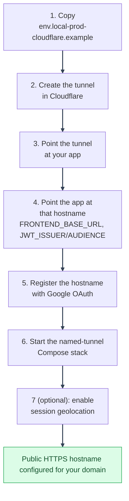

# Cloudflare Named Tunnel (stable URL)
---

See [Local-Prod Deployment](README.md) for the mode chooser, environment
variables, and how local-prod differs from dev/prod. This page is the
stable-URL Cloudflare Named Tunnel walkthrough, start to finish.

---

## Files used by this guide

| File | Why it matters |
|---|---|
| `docker/mystic_auth/compose/docker-compose.local-prod-cloudflare.yml` | Defines the stack and runs Cloudflare Named Tunnel by default. |
| `env/mystic_auth/.env.local-prod-cloudflare.example` | Source template for Cloudflare local-prod application settings. |
| `env/mystic_auth/.cloudflare-tunnel-token.example` | Empty secret-file template. Copy it to `.cloudflare-tunnel-token` and place the tunnel token there. |
| `env/mystic_auth/.env.local-prod-cloudflare` | Your local, gitignored copy with the public hostname, Google callback, and application secrets. |
| `scripts/mystic_auth/docker/local-prod-cloudflare/local-prod-cloudflare-up.*` | Compose helpers that always pass the Cloudflare env file. |
| `local-scripts/mystic_auth/local-prod-cloudflare/create-system-user.*` | Optional non-interactive system-superuser creation scripts. |

---

## Platform setup

Requires a domain added to a free Cloudflare account. The domain's DNS
zone must live in *your own* Cloudflare account for tunnel routing to
work. A subdomain donated by a third-party registry repo (`is-a.dev`,
`rweb.site`, etc.) will not work here, since Cloudflare Tunnel resolves the
target tunnel by matching the request against Public Hostname config in
the account that owns the zone: a zone you don't control can't route to
a tunnel it doesn't know about. If you want a custom hostname and do not own a domain yet, you can buy one
from a registrar and delegate its DNS to your Cloudflare account. For a short
demo without a custom domain, use a [Quick Tunnel](cloudflare-quick-tunnel.md).

Cloudflare Named Tunnel authenticates with a persistent token mounted from
a file-backed Compose secret. The repository builds a pinned Cloudflare
source release with the patched `klauspost/compress` dependency and includes
a readiness health check. The token never enters the container environment or
process arguments.

Traffic enters Cloudflare at `https://your-hostname`, then Cloudflare routes
that hostname to the named tunnel, and `cloudflared` forwards it to
`http://frontend:80` inside Docker.

---



---

**Step 1: Copy the env files and create the token secret file.**

```bash
cp env/mystic_auth/.env.local-prod-cloudflare.example env/mystic_auth/.env.local-prod-cloudflare
cp env/app/.env.local-prod-cloudflare.example env/app/.env.local-prod-cloudflare
cp env/mystic_auth/.cloudflare-tunnel-token.example env/mystic_auth/.cloudflare-tunnel-token
chmod 600 env/mystic_auth/.cloudflare-tunnel-token
```

On Windows PowerShell, restrict the file ACL instead of using `chmod`:

```powershell
icacls env\mystic_auth\.cloudflare-tunnel-token /inheritance:r /grant:r "$([System.Security.Principal.WindowsIdentity]::GetCurrent().Name):(R)" "SYSTEM:(R)" "BUILTIN\Administrators:(R)"
```

Keep the token file out of git. The startup helper checks that it exists, is
non-empty, and restricts access to your account, SYSTEM, and Administrators
on Windows. On Unix it requires no group/world permissions. Paste the token from
the Cloudflare Zero Trust install screen into this file, not the `.env` file.

This Compose file includes a Named Tunnel service. For a temporary Quick Tunnel
demo with the same app stack, follow the [Quick Tunnel walkthrough](cloudflare-quick-tunnel.md),
which starts the frontend and app services without starting `cloudflared`.

Do not start local-prod from `env/mystic_auth/.env.dev.example`; that file is
for the dev stack.

---

**Step 2: Create the tunnel in Cloudflare.**

Zero Trust dashboard → Networks → Tunnels → Create a tunnel → Cloudflared
→ name it. Copy the token shown in the install step into
`env/mystic_auth/.cloudflare-tunnel-token`.

---

**Step 3: Point the tunnel at your app.**

Still in that tunnel's config: Public Hostname → Add a public hostname →
your domain or subdomain → Service: HTTP → `http://frontend:80`.

---

**Step 4: Point the app at that hostname.**

In `env/mystic_auth/.env.local-prod-cloudflare`, set `FRONTEND_BASE_URL` and `BACKEND_BASE_URL` to
`https://your-hostname` once it's live. Leave `VITE_API_BASE_URL` empty:
frontend and backend share one public origin behind the tunnel, and nginx
(`docker/mystic_auth/nginx.frontend.conf`) proxies API prefixes to `backend`
same-origin, so the browser never needs a separate API URL.

Also set `JWT_ISSUER` and `JWT_AUDIENCE` to `https://your-hostname`. They
don't have to match `FRONTEND_BASE_URL` for tokens to work (they're only
checked against themselves, see
[Authentication Overview](../../authentication/overview.md)), but leaving
them at the placeholder default means every deployment that copies this
tutorial mints tokens with the same `iss`/`aud`.

---

**Step 5: Register the hostname with Google and enable Google login.**

In the [Google Cloud Console](https://console.cloud.google.com/), under
**APIs & Services**, **Credentials**, your OAuth 2.0 Client ID, add
`https://your-hostname/auth/oauth2/callback/google` under **Authorized
redirect URIs** and `https://your-hostname` under **Authorized
JavaScript origins**. Then set `GOOGLE_REDIRECT_URI` in `env/mystic_auth/.env.local-prod-cloudflare` to that
same redirect URI. It must match byte-for-byte, or login fails with
`redirect_uri_mismatch`.

---

**Step 6: Start the stack.**

```bash
./scripts/mystic_auth/docker/local-prod-cloudflare/local-prod-cloudflare-up.sh
# PowerShell: .\scripts\mystic_auth\docker\local-prod-cloudflare\local-prod-cloudflare-up.ps1
```

Open `https://your-hostname` in a browser: that's your app, live at a
stable address. Unlike Quick Tunnel, this URL doesn't change, so Steps 4
and 5 are one-time setup, not something you repeat on every restart. See
[OAuth2 / PKCE](../../authentication/oauth2-pkce.md#troubleshooting) if login
still fails after this.

---

**Step 7b (Optional): Enable session geolocation.**

Setting `GEOIP_DB_PATH`/`GEOIPUPDATE_ACCOUNT_ID`/`GEOIPUPDATE_LICENSE_KEY` in
`env/mystic_auth/.env.local-prod-cloudflare` alone does nothing: the `geoipupdate` service that downloads the
`.mmdb` file is gated behind the `geoip` Compose profile, skipped by the startup command as written. Re-run the helper with the profile added instead:

```bash
./scripts/mystic_auth/docker/local-prod-cloudflare/local-prod-cloudflare-up.sh --profile geoip up -d --build
```

Without it, the updater is not started and Manage Sessions' Location column
shows "Unknown". When the profile is enabled, the updater healthcheck now
requires a non-empty database and becomes unhealthy if the download fails. See
[Session Geolocation](../../geolocation/overview.md)
for the MaxMind account/license-key setup this depends on.

---

## Troubleshooting

| Symptom | Cause | Fix |
|---|---|---|
| Cloudflare hostname returns 404 or tunnel not found | Public Hostname is not attached to the tunnel whose token is in `.cloudflare-tunnel-token`. | In Cloudflare Zero Trust, open the tunnel, then verify Public Hostname points to `http://frontend:80`. |
| DNS does not resolve your hostname | Domain nameservers are not delegated to your Cloudflare account or DNS has not propagated yet. | Check the domain in Cloudflare DNS and wait for delegation. New domains can take longer than the tunnel setup itself. |
| `cloudflared` exits immediately | The token file is missing, empty, or invalid. | Put the token from the tunnel install step in `env/mystic_auth/.cloudflare-tunnel-token`, keep Unix permissions at `0600`, then restart the stack. |
| Google login returns `redirect_uri_mismatch` | Google Cloud Console callback does not match `GOOGLE_REDIRECT_URI`. | Register `https://your-hostname/auth/oauth2/callback/google` under Authorized redirect URIs. |
| API calls return 502 after changing backend env values | nginx cached the previous backend container IP. | Recreate `backend` and `frontend` together with `--force-recreate`. |

---
