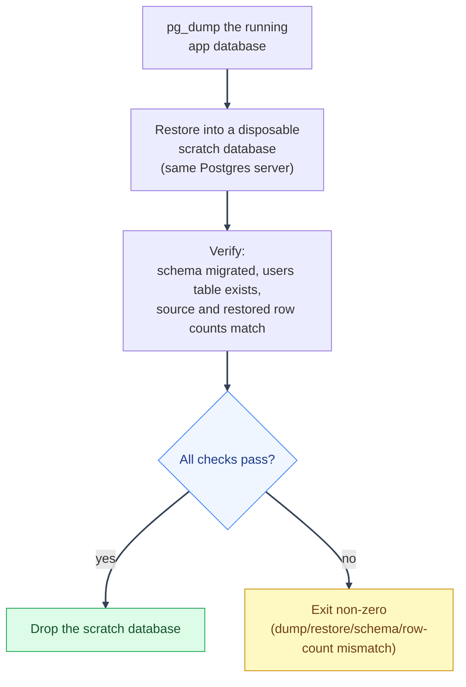

# Migrations and Backups
---

*New to a term here? See the [Infrastructure Glossary](../glossary/infrastructure.md).*

Deployment operations for Alembic migrations, encrypted database dumps, restore commands, and recovery checks.

---

## 1. Database migrations
---

The `alembic` service runs `alembic upgrade head` once and exits. In production-shaped Compose files, `backend` and `procrastinate_worker` wait for it with `condition: service_completed_successfully`, so request traffic does not start against an unmigrated schema.

Before applying a migration in production:

1. Review the migration file under `backend/alembic/versions/`.
2. Pay special attention to dropped columns, altered types, data migrations, role changes, and destructive SQL.
3. Confirm the migration has a downgrade only when rollback is actually safe.
4. Run the test suite or at least the migration check in a production-like database copy.

Migrations run with `DATABASE_URL`, normally the Postgres superuser. Runtime app traffic and Procrastinate task bodies prefer `APP_DATABASE_URL`, the least-privilege role created by migration. See [Security Decisions: Least-privilege app DB role](../security/decisions-infra.md#least-privilege-app-db-role-instead-of-running-as-postgres-superuser).

### Invalidating the authorization cache after an out-of-band write

A migration backfill, or a one-off `psql`/support script, that changes who holds which policy or permission bypasses the normal API-driven cache invalidation: affected users can see a stale authorization decision for up to 60 seconds (`_USER_POLICIES_TTL_SECONDS` in `authorization_cache_service.py`). Run this right after any such write:

```bash
# After an out-of-band UserPermission/UserPolicy change for specific users
python -m mystic_auth.scripts.invalidate_authorization_cache --email a@example.com --email b@example.com

# After editing a Policy's own definition (actions/resource_type/conditions),
# which can affect every holder, not just one
python -m mystic_auth.scripts.invalidate_authorization_cache --all-policies
```

An API-driven grant/revoke never needs this - it invalidates the cache itself already.

### PostgreSQL 15 to 18 data-volume upgrade

The Compose files now use PostgreSQL 18. PostgreSQL data directories are not
portable across major versions: do not start the PostgreSQL 18 image against a
volume initialized by PostgreSQL 15, and do not remove the old volume as part
of the upgrade. This is a dump-and-restore migration, separate from Alembic.

Before changing a deployment:

1. Keep the existing PostgreSQL 15 stack running and take encrypted dumps of
   both `POSTGRES_DB` and `bugsink` with the existing release's backup script.
2. Run the restore drill against that source stack and verify both dumps have
   matching HMAC sidecars. Copy the encrypted dumps and sidecars to storage
   that will remain available if the host fails.
3. Choose a new, unique Compose project name for the PostgreSQL 18 stack. A
   different project name gives it a new `postgres_data` volume while leaving
   the PostgreSQL 15 volume untouched.
4. Start only the new `postgres` service, restore the app and Bugsink dumps
   into it, and run the restore drill against the new project. Then start the
   complete new stack so its Alembic service applies any schema migrations.
5. Verify backend readiness, frontend behavior, worker health, and the
   deployment-specific smoke checks before directing traffic to the new
   stack. Keep the old Compose project, release configuration, and data
   volume until the new stack has passed acceptance.

For a production-mode candidate, substitute the selected mode's Compose file
and env-file suffix in these commands. The project-name override is inherited
by the helper scripts, so their `docker compose exec` calls target the new
PostgreSQL 18 service:

```bash
export COMPOSE_PROJECT_NAME=mystic-auth-pg18-candidate

docker compose \
  -f docker/mystic_auth/compose/docker-compose.prod.yml \
  -f docker/app/compose/docker-compose.prod.yml \
  --env-file env/mystic_auth/.env.prod \
  --env-file env/app/.env.prod \
  up -d postgres

scripts/mystic_auth/db/database-restore/database-restore.sh \
  backups/<app-database-dump>.dump.enc docker-compose.prod.yml --yes
scripts/mystic_auth/db/database-restore/database-restore.sh \
  backups/bugsink-<timestamp>.dump.enc docker-compose.prod.yml --yes
scripts/mystic_auth/db/database-restore/database-restore-drill.sh \
  docker-compose.prod.yml

docker compose \
  -f docker/mystic_auth/compose/docker-compose.prod.yml \
  -f docker/app/compose/docker-compose.prod.yml \
  --env-file env/mystic_auth/.env.prod \
  --env-file env/app/.env.prod \
  up -d
```

The examples use placeholders for the dump names. Keep the same
`BACKUP_ENCRYPTION_KEY` available to the restore helper that encrypted the
source dumps. Schedule a maintenance window: both stacks cannot serve the
same public ports at once, and the old application must stop writing before
the final source backup. Do not run `docker compose down -v` on the old
project. A rollback after the new database accepts writes needs a deliberate
data-reconciliation plan; simply switching back would discard those writes.

---

## 2. Backup scripts
---

`scripts/mystic_auth/db/database-backup/database-backup.sh` and `scripts/mystic_auth/db/database-restore/database-restore.sh` wrap Docker Compose, `pg_dump`, and `psql`. Every operator-facing database helper in that directory has matching `.ps1` and `.cmd` entry points; those Windows wrappers delegate to the same tested Bash implementation through Git Bash. Use `.sh` from Bash/WSL/Linux/macOS, `.ps1` from PowerShell, or `.cmd` from Command Prompt with the same arguments. Production-shaped Compose files use a custom pinned Postgres Alpine client image with a checksum-pinned rclone build, OpenSSL, and `curl` installed. Backups are encrypted with AES-256-CBC using PBKDF2 before they are written to `./backups`; the key is never stored beside the backup files. The manual script accepts `BACKUP_DIR=/path/to/writable/dir` when the scheduled sidecar owns the default bind-mounted directory as UID 10001.

The application database name is always taken from `POSTGRES_DB` in the
selected mode's environment files. It is not required to be `mystic_auth`:
downstream applications may use a name such as `example_app_db`. The encrypted
backup round-trip test and restore-drill regression check follow the same
setting and check the configured application database plus the separate
`bugsink` database, so template and downstream runs exercise the same
database-selection contract.

CBC has no authenticated-encryption mode of its own (`openssl enc -aes-256-gcm` fails outright - the `enc` subcommand doesn't support AEAD ciphers at all), so `scripts/mystic_auth/db/backup-verification/backup-hmac.sh` adds the missing tamper-evidence separately: every `<dump>.dump.enc` gets a detached HMAC-SHA256 tag written alongside it as `<dump>.dump.enc.hmac`, using a MAC key derived from `BACKUP_ENCRYPTION_KEY` (not the raw passphrase itself). `backup-upload.sh` ships the tag off-host with the dump automatically. `database-restore.sh` verifies the tag before decrypting a `.dump.enc` file - a present-but-mismatched tag aborts the restore; a missing tag (a dump made before this existed) only warns, so older backups stay restorable.

Run `scripts/mystic_auth/db/backup-verification/backup-freshness-check.sh` from an external
monitoring scheduler to verify that every required database has a recent,
non-empty dump. It defaults to twice `BACKUP_INTERVAL_HOURS` and checks
`POSTGRES_DB` plus `bugsink`; set `BACKUP_MAX_AGE_HOURS` or pass the directory
and maximum age explicitly when the deployment needs a different policy:

```bash
BACKUP_MAX_AGE_HOURS=30 scripts/mystic_auth/db/backup-verification/backup-freshness-check.sh /backups
```

The check does not claim that an off-host object exists or that a dump can be
restored. Use the restore drill for restoreability and monitor the B2 bucket
itself for off-host freshness.

Run `scripts/mystic_auth/db/backup-verification/check-backup-encryption.sh`
periodically (or from the same external scheduler as the freshness check) to
find plaintext `.dump`/`.sql` files and encrypted dumps with missing, empty, or
malformed HMAC sidecars. This catches backup artifacts left behind during a
format change even though restore itself tolerates a missing HMAC tag on an
older dump (see above). The check defaults to `./backups`; pass a directory
explicitly to check another location. Set `BACKUP_ENCRYPTION_KEY` in the
scheduler's secret environment to also verify each HMAC against the ciphertext.
Without the key, the script checks that each sidecar is well formed but cannot
authenticate it.

```bash
scripts/mystic_auth/db/backup-verification/check-backup-encryption.sh /backups
```

When `BACKUP_ENCRYPTION_KEY` is present in the scheduler's environment, the
same command also verifies each tag against its ciphertext.

```bash
# Dump the dev database and Bugsink database, if enabled
scripts/mystic_auth/db/database-backup/database-backup.sh

# Dump a production-shaped stack
scripts/mystic_auth/db/database-backup/database-backup.sh docker-compose.local-prod-ngrok.yml

# Restore an encrypted dump, with confirmation
scripts/mystic_auth/db/database-restore/database-restore.sh backups/mystic_auth-20260717-120000.dump.enc

# Restore without confirmation
scripts/mystic_auth/db/database-restore/database-restore.sh -y backups/mystic_auth-20260717-120000.dump.enc
```

### Backblaze B2 off-host copies
---

Create a B2 bucket in the Backblaze dashboard with these choices:

1. Give it a globally unique name, such as `mystic-auth-backups-<owner>`.
2. Keep **Files in Bucket** set to **Private**.
3. Enable **Default Encryption**.
4. Enable **Object Lock** for a real backup bucket, then configure a 14-day
   Governance-mode default retention. Object Lock is irreversible, so leave it
   disabled only for a temporary test bucket.

Backblaze's current signup offers 10 GB of free storage without requiring a
billing method. Usage above the free allowance can still incur charges, so
configure B2 caps and alerts.

Create an application key with these choices:

1. The key name is just a label, for example `mystic-auth-backups`.
2. Restrict **Allow access to Bucket(s)** to this backup bucket.
3. Select **Read and Write**.
4. Leave **Allow List All Bucket Names**, **File name prefix**, and **Duration**
   empty.
5. Copy the generated **keyID** and **applicationKey**. The key name is not a
   credential.

Keep the application key in the deployment secret store, not in git. In the
environment file used by the production-shaped Compose file, map **keyID** to
`RCLONE_CONFIG_B2_ACCOUNT` and **applicationKey** to
`RCLONE_CONFIG_B2_KEY`:

```dotenv
B2_BUCKET=mystic-auth-production-backups
RCLONE_CONFIG_B2_ACCOUNT=<keyID>
RCLONE_CONFIG_B2_KEY=<applicationKey>
BACKUP_UPLOAD_COMMAND=rclone copyto "$${DUMP_FILE}" "b2:mystic-auth-production-backups/$$(basename "$${DUMP_FILE}")"
# Keep this in a secret manager and separately from ./backups.
BACKUP_ENCRYPTION_KEY=<64-character-secret>
```

The doubled dollar signs are required in a Compose environment file so
Compose passes the variable references through to the backup container. Use
the real bucket name in both `B2_BUCKET` and the `b2:<bucket-name>/...` part of
the command. Do not copy these credentials into an `.example` file.

The scheduled `db_backup` image contains `rclone`; the manual backup command
uses the same hook and therefore needs `rclone` installed on the host. Every
dump is checked with `pg_restore --list` before this command runs. Dump,
verification, and upload failures are reported through the same Sentry
protocol DSN used by the backend. The scheduled service reads the generated
Bugsink DSN from its shared Compose volume. For a manual host-side backup,
export `BACKUP_SENTRY_DSN` if the host cannot read that volume.

After configuring the bucket, verify both directions:

```bash
make restore-drill
scripts/mystic_auth/db/database-backup/database-backup.sh docker-compose.prod.yml
rclone lsjson "b2:${B2_BUCKET}"
rclone copyto "b2:${B2_BUCKET}/<dump-name>.dump.enc.hmac" /tmp/<dump-name>.dump.enc.hmac
rclone copyto "b2:${B2_BUCKET}/<dump-name>.dump.enc" /tmp/<dump-name>.dump.enc
scripts/mystic_auth/db/backup-verification/backup-hmac.sh verify /tmp/<dump-name>.dump.enc "$BACKUP_ENCRYPTION_KEY" && echo "HMAC OK"
openssl enc -d -aes-256-cbc -pbkdf2 -in /tmp/<dump-name>.dump.enc \
  -pass env:BACKUP_ENCRYPTION_KEY | pg_restore --list
```

The restore drill in the repository checks a local dump. A deployment
acceptance check must also download one named B2 object and restore that copy
into a disposable database, then compare its schema and row counts. Periodic
full dumps do not provide point-in-time recovery; use WAL archiving or managed
Postgres if the backup interval is too large for the required RPO.

The restore target is inferred from the dump filename. A `bugsink-*.sql` file restores into the `bugsink` database.

---

## 3. Restore drill
---

A backup nobody has tried to restore is a hope, not a guarantee.
`scripts/mystic_auth/db/database-restore/database-restore-drill.sh` proves the whole path actually
works: it dumps the running app database, restores that dump into a
disposable scratch database on the same Postgres server (never touching the
real one), runs a smoke check against it (the schema migrated and the
`users` table exists), then drops the scratch database.



The real database is never touched by any step above - the drill's whole point is proving
restorability without risking the thing it's protecting.

The drill reads both `POSTGRES_DB` and `POSTGRES_USER` from the selected
environment (or the corresponding exported variables). Keep those values
aligned with the database container; the scripts intentionally do not assume
the role is named `postgres`.

```bash
# Prove the dev stack's own database is restorable
scripts/mystic_auth/db/database-restore/database-restore-drill.sh

# Same, against a production-shaped stack
scripts/mystic_auth/db/database-restore/database-restore-drill.sh docker-compose.local-prod-ngrok.yml
```

Exits non-zero on any failure (dump, restore, or a missing/empty schema in
the result), so a broken backup path fails loudly here instead of only
being discovered mid-incident. `tests/scripts/mystic_auth/db/test-restore-drill.sh`
runs this as a regression test in CI's `browser-e2e` Chromium desktop job, against the dev
stack's own database, on every push.

This is how a real bug was found and fixed while building this drill:
`pg_dump --format=custom --file=-` silently wrote a 0-byte dump on this
image's `pg_dump` build instead of writing to stdout, and `database-backup.sh`
used exactly that pattern. Both scripts now omit `--file` and rely on
stdout redirection instead, which works portably regardless of that
behavior. See the fixed line's own comment in either script for the detail.

---

## 4. Scheduled backup sidecar
---

`docker-compose.prod.yml` and every `docker-compose.local-prod-*.yml` variant run a `db_backup` service by default.

| Setting | Purpose |
|---|---|
| `BACKUP_INTERVAL_HOURS` | Hours between scheduled dumps. |
| `BACKUP_RETENTION_DAYS` | Local retention window for old dump files. |
| `BACKUP_ENCRYPTION_KEY` | Required secret used to encrypt/decrypt `.dump.enc` files. Store it in a secret manager, not with the backups. |
| `BACKUP_UPLOAD_COMMAND` | Required in production-shaped modes; runs after each verified encrypted dump, with `DUMP_FILE` exported to it, to ship the dump off-host. |
| `./backups` | Host directory where dumps are written. |

This is a periodic `pg_dump` loop with encryption, structural verification, and a fail-fast off-host upload requirement in production-shaped modes. `scripts/mystic_auth/db/database-backup/database-backup.sh` (manual/on-demand backups) honors the same encryption and upload settings for parity.

The backup sidecar remains attached to the private `postgres_net` for Postgres
access and also uses a separate non-internal `backup_egress_net` solely for
off-host upload. It has no connection to Valkey's separate internal network.

The scheduled backup image includes `rclone` and uses the B2 environment
variables above. A host running the manual script needs `rclone` installed
locally.

---

## 5. Backup limitations
---

Operational boundaries:

1. Production-shaped Compose modes fail to start without both `BACKUP_ENCRYPTION_KEY` and `BACKUP_UPLOAD_COMMAND`; this prevents an unprotected deployment from appearing healthy.
2. There is no point-in-time recovery - periodic full dumps only, so worst-case data loss is up to `BACKUP_INTERVAL_HOURS` of writes.
3. Encryption protects backup confidentiality, but losing `BACKUP_ENCRYPTION_KEY` makes recovery impossible. Escrow it separately and test recovery with the restore drill.

Each dump is already verified with `pg_restore --list` immediately after writing, so a corrupt dump is caught before it's trusted, not after a restore is attempted. Beyond that structural check, run [the restore drill](#3-restore-drill) periodically against production data to confirm the whole pipeline, not just the dump file, works end to end.

---

## 6. Off-host copy without a cloud account
---

If there is no cloud account and no second server, use encrypted removable media as the minimum off-host path.

```bash
# One-time repository setup on mounted removable media
restic -r /mnt/usb-backup/mystic-auth init

# After each backup
restic -r /mnt/usb-backup/mystic-auth backup ./backups
restic -r /mnt/usb-backup/mystic-auth forget --keep-daily 14 --keep-weekly 8 --prune
```

Store the Restic password somewhere separate from the drive, such as a password manager. Disconnect the drive and keep it away from the host when possible.

When a second machine is available, use the same repository model over SFTP:

```bash
restic -r sftp:USER@REMOTE_HOST:/backups/mystic-auth init
restic -r sftp:USER@REMOTE_HOST:/backups/mystic-auth backup ./backups
```

Also keep a recoverable copy of the relevant env file, such as `env/mystic_auth/.env.prod` or `env/mystic_auth/.env.local-prod-ngrok`. A database dump without `SECRET_KEY`, database passwords, and provider secrets is not enough to recover the application.

---
