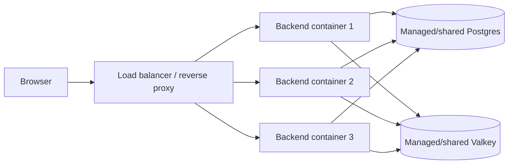

# Scaling and Multiple Backend Containers
---

*New to a term here? See the [Infrastructure Glossary](../glossary/infrastructure.md).*

How many backend workers to run on one host, how to measure it, and what changes when you move to several backend containers.

---

## 1. Sizing workers on one host
---

`UVICORN_WORKERS` (prod-shaped deployments only; `dev` uses `--reload`, which
forces a single process) sets how many uvicorn worker processes the
`backend` service runs, each with its own DB connection pool sized by
`DB_POOL_SIZE`/`DB_MAX_OVERFLOW`. Keep
`UVICORN_WORKERS * (DB_POOL_SIZE + DB_MAX_OVERFLOW)` under Postgres's own
`max_connections` (100 by default), leaving headroom for
`alembic`/`procrastinate_worker`/`db_backup`'s own connections.

**Left unset (the shipped default), it auto-sizes on every boot** to
`min(host CPU cores, the container's CPU limit, 4)` (the limit is read from the container's cgroup `cpu.max`, so a 2-CPU container on a 12-core host gets 2 workers, not 4) - every prod-shaped Compose file (`prod`,
`local-prod-cloudflare`, `local-prod-ngrok`, `local-prod-tailscale`) runs
this same `nproc`-based calculation in its `backend` service's startup
command and logs which value it picked (`docker logs <backend container>`
shows `[backend] UVICORN_WORKERS not set - auto-sizing to N worker(s)`).
Sizing by the container limit matters: more workers than CPUs only makes them fight over the same quota, and the container is throttled as a whole, which stalls every worker's event loop. The cap at 4 is deliberate, not a host-size guess: with the default
`DB_POOL_SIZE=5`/`DB_MAX_OVERFLOW=10`, 4 workers tops out at 60 of
Postgres's default 100 `max_connections`, leaving headroom regardless of
how many cores the host actually has. Set `UVICORN_WORKERS` explicitly to
override in either direction - fewer on a host you're sharing with other
services, more on a box with real spare capacity (raise
`DB_POOL_SIZE`/`DB_MAX_OVERFLOW` to match if you do, per the formula
above).

Measured on a local-prod-ngrok stack with `wrk` (4 threads, 200 persistent connections, 15s, `GET /health/ready`). `scripts/mystic_auth/load-test/load_test.py` (one process per CPU core by default) gives comparable numbers:

| Config | Throughput | Timeouts (of ~5,000 req) | Notes |
|---|---|---|---|
| `UVICORN_WORKERS=1` | 299 req/s | 175 | Single event loop; Argon2 and JSON work all serialize behind it |
| `UVICORN_WORKERS=4` (shipped default, this host has 12 cores) | 375 req/s | 31 | ~25% higher throughput, ~82% fewer timeouts, same host |

The gain here is real but modest compared to a dedicated benchmarking
host, because Postgres, Valkey, and every other stack service were
competing for the same machine's cores during the test - representative
of a small self-hosted box, not a provisioned multi-machine deployment.
Re-run the comparison yourself against your own target hardware before
trusting either number, using [`wrk`](https://github.com/wg/wrk) (packaged
for most distros - `apt install wrk` on Debian/Ubuntu, `brew install wrk`
on macOS - so you're running a package-manager-verified build, not an
unaudited third-party Docker image):
```bash
wrk -t4 -c200 -d15s http://localhost:<BACKEND_HOST_PORT>/health/ready
```

`POST /auth/login` is the outlier: capped around 15-20 req/s regardless of
worker count, since Argon2 password verification is deliberately
CPU-expensive per request (see `backend/mystic_auth/auth/password_logic/password_service.py`) -
more workers help concurrency, not this per-request cost.

---

## 2. Running multiple backend containers
---

The Compose files in this repository are a one-host deployment shape. When
one host is the capacity ceiling, run multiple identical backend containers
behind a load balancer and move the data services to shared infrastructure:



1. Provision one managed or separately shared Postgres instance and one
   managed or separately shared Valkey instance. Set every replica's
   `APP_DATABASE_URL`/`DATABASE_URL` and `VALKEY_URL` to those shared endpoints.
   Do not point replicas at the `postgres` and `valkey` service names from the
   single-host Compose files. Separate data containers would split state.
2. Size the total database connection budget across all replicas and workers:
   `replicas * UVICORN_WORKERS * (DB_POOL_SIZE + DB_MAX_OVERFLOW)`, plus
   connections for the migration runner, `procrastinate_worker`, and backups.
   Keep that total below the shared Postgres limit with operational headroom.
3. Run `cd backend && alembic upgrade head` exactly once per deployment, from a
   release job or one explicitly selected migration task. Route traffic to new
   replicas only after it succeeds. Do not let every replica run migrations
   during startup.
4. Use the same `SECRET_KEY`, `JWT_ISSUER`, `JWT_AUDIENCE`, cookie settings,
   and application configuration on every replica. Access and refresh tokens
   are in cookies and are verified by each replica, so sticky sessions are not
   required. OAuth state, token-version invalidation, rate limits, and
   session-event publication use Valkey and must not fall back to memory.
5. Encrypt the connections to the shared data services. On the single-host
   Compose files this is not needed: the Postgres and Valkey containers sit on
   `internal: true` networks with no route off the host, so only the services
   attached to those networks can reach them. Once replicas talk to Postgres and
   Valkey over a real network, traffic carries password hashes, session state
   and tokens, so require TLS and have the client verify the server certificate
   (a managed provider normally gives you this). Use `rediss://` in `VALKEY_URL`,
   and enable TLS in the Postgres URLs. The backend and the migration runner can
   use different drivers, so check each URL's driver documentation for its TLS
   option. This repository's tests do not exercise TLS connections, so verify
   them in your own deployment.

The live `/auth/session-events` connection is held by the process that
accepted it. A reconnect can land on another replica, so clients must handle
reconnects; a backend process is not durable session state. Process-local
logging/context state and the SQLAlchemy pool are not user session state.
Postgres and Valkey are the shared sources of truth.

An nginx instance or managed load balancer can use the existing readiness
endpoint as its backend health check. This nginx-style upstream illustrates
the routing decision:

```nginx
upstream mystic_auth_backend {
    server backend-1.internal:8000 max_fails=3 fail_timeout=10s;
    server backend-2.internal:8000 max_fails=3 fail_timeout=10s;
    server backend-3.internal:8000 max_fails=3 fail_timeout=10s;
}

server {
    listen 443 ssl;

    location / {
        proxy_pass http://mystic_auth_backend;
        proxy_set_header Host $host;
        proxy_set_header X-Forwarded-For $proxy_add_x_forwarded_for;
        proxy_set_header X-Forwarded-Proto $scheme;
    }

    # Active check: GET /health/ready, expect HTTP 200.
    # It returns 503 when Postgres or Valkey is unavailable.
}
```

Use `/health` only as a liveness check. Use `/health/ready` for traffic
eligibility because it checks both shared dependencies. Preserve the trusted
proxy configuration described in [Routing: Trusted proxy IPs](routing.md#2-trusted-proxy-ips)
when the load balancer adds `X-Forwarded-For`.
