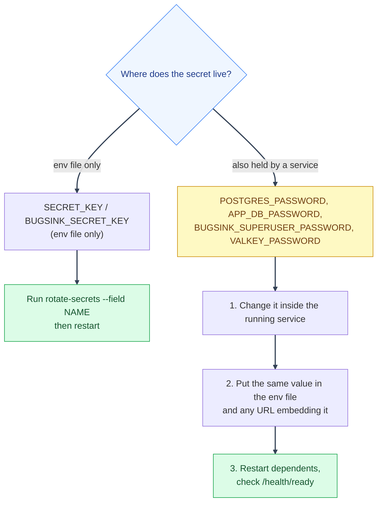

# Rotating Secrets
---

*New to a term here? See the [Infrastructure Glossary](../glossary/infrastructure.md).*



How often is up to you: after a suspected leak, when someone with access leaves, and otherwise on a schedule you can keep up with. The tooling splits the secrets into two kinds.

**Env-file only (use the script).** `SECRET_KEY` and `BUGSINK_SECRET_KEY` live only in the env file, so editing the file and restarting is the whole rotation:

```bash
scripts/mystic_auth/env-tools/rotate-secrets/rotate-secrets.sh --field SECRET_KEY env/mystic_auth/.env.prod
```

Rotating `SECRET_KEY` invalidates every signed token, so all users are signed out. Do it at a quiet time.

**Also held by a running service (change it there first).** `POSTGRES_PASSWORD`, `APP_DB_PASSWORD`, `BUGSINK_SUPERUSER_PASSWORD` and `VALKEY_PASSWORD` are stored by the service itself. Editing the env file alone does not change the real password and leaves the app unable to connect on its next restart. The script deliberately does not touch these, because it would need live database credentials. Rotate them in this order:

1. Change the password inside the running service: for Postgres, `ALTER ROLE <role> PASSWORD '<new>';` from `psql` in the postgres container; for Bugsink, its own admin tools; for Valkey, change `requirepass` and restart it with the new value.
2. Put the same new value in the env file (and in any URL that embeds it, such as `DATABASE_URL`).
3. Restart the services that use it, then check `/health/ready`.

If step 2 or 3 fails, the old password is already gone, so keep the new value somewhere safe until the stack is healthy again.

The backup key is separate: keep every old `BACKUP_ENCRYPTION_KEY` until the backups made with it have expired (see [database backups](database-backups.md)).
