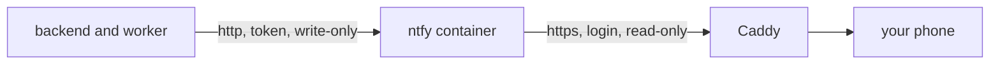

# Private security alerts with self-hosted ntfy

The app sends its security alerts (an account cool-down, a policy change, a failed background job, refresh-token reuse) to a small [ntfy](https://ntfy.sh) server that runs next to it in Docker. Your phone subscribes to that server. The alert text never goes through a third-party service.

This page covers production first, then local testing, then what to do if something does not arrive.

## How it is wired



- `alert_net` is an internal Docker network with no route to the internet. Only the backend, the worker and ntfy are on it, so the app posts alerts without ever leaving the host.
- ntfy denies everything by default. Two accounts exist and nothing else:
  - `mystic-auth-app`: can only write to the alert topic. The backend uses its token.
  - `phone` (name is your choice): can only read the alert topic. Your phone uses its password.
- A leaked phone password cannot post fake alerts. A leaked app token cannot read alerts.
- There is no ntfy web page, no sign-up and no login page (`NTFY_WEB_ROOT=disable`).

## Production setup

1. **DNS.** Create an `A` record `ntfy.<your-domain>` pointing at the same host as the app.
2. **Env file** (`env/mystic_auth/.env.prod`). The defaults already point the app at the container; set the public name:

   ```dotenv
   NTFY_BASE_URL=https://ntfy.<your-domain>
   NTFY_PUBLIC_DOMAIN=ntfy.<your-domain>
   ```

   `SECURITY_ALERT_WEBHOOK_URL` stays `http://ntfy:8080/mystic-auth-alerts` and `SECURITY_ALERT_WEBHOOK_FORMAT` stays `ntfy`. The URL may use plain `http` only because `ntfy` is a Docker service name that exists on the private network. Any dotted host must use `https`.
3. **Start the stack.** Caddy gets the certificate for the ntfy name by itself, the same way it does for the app.
4. **Create the accounts.**

   ```bash
   scripts/mystic_auth/ntfy/ntfy-setup.sh docker-compose.prod.yml
   ```

   It creates the two accounts, limits each to the alert topic, sends a test message and prints the phone password (once) and the app token. It is safe to run again: existing accounts are kept.
5. **Give the token to the app.** Copy the printed line into `.env.prod`:

   ```dotenv
   SECURITY_ALERT_WEBHOOK_TOKEN=tk_...
   ```

   Then start the stack again so the backend and worker pick it up.
6. **Set up the phone** (next section).

## Phone setup

**Android**

1. Install **ntfy** from F-Droid or the Play Store.
2. Open the menu, **Settings**, **Manage users**, **Add user**. Enter the server `https://ntfy.<your-domain>`, the username `phone` and the password from step 4.
3. Back on the main screen tap **+**, enter the topic `mystic-auth-alerts`, turn on **Use another server** and enter `https://ntfy.<your-domain>`. Subscribe.
4. In Settings turn on **Instant delivery** so Android keeps the connection open, and exclude the app from battery optimisation. Without this Android may delay the messages.

**iPhone**

1. Install **ntfy** from the App Store and add the user and subscription as above.
2. iOS has no way to keep a connection open, so a self-hosted server must ask Apple's push service to wake the app. Set this in `.env.prod`:

   ```dotenv
   NTFY_UPSTREAM_BASE_URL=https://ntfy.sh
   ```

   ntfy then tells ntfy.sh only that a new message exists on a topic, using a hash of the topic name. The message text is never sent. Restart the stack after changing it.

**Check it.** The setup script already sent "ntfy setup test". If it showed on your phone, you are done. To see a real alert, use a test account and enter a wrong password 20 times. A `login_account_cooldown` message arrives.

## Local testing

The three local-prod stacks run the same ntfy container. It listens on `127.0.0.1:8190` of your machine only (change it with `NTFY_LOCAL_PORT`). Run the same setup script with the matching compose file, for example:

```bash
scripts/mystic_auth/ntfy/ntfy-setup.sh docker-compose.local-prod-ngrok.yml
```

A phone cannot reach `127.0.0.1`, so check delivery from the terminal instead:

```bash
curl -u phone:<password> "http://localhost:8190/mystic-auth-alerts/json?poll=1"
```

To receive messages on a real phone while testing, the phone needs a route to port 8190, for example the Tailscale mode, or any tunnel you already trust. Treat that as optional; the production setup above is where the phone matters.

## Check that it works

- On start the backend logs one warning if the URL is empty or a placeholder such as `example.com`. No warning means the URL looks real.
- Wrong login for 20 attempts on a test account produces one alert; see the access rules in the table below if you get `403`.
- A failed delivery is retried five times over about a minute and a half. After that the job stays as `failed` in `procrastinate_jobs` for 30 days: `SELECT id, status, attempts FROM procrastinate_jobs WHERE task_name LIKE '%deliver_security_alert%'`.
- The worker log shows `Security alert delivery failed for <event>` with the reason.

| Request | Result |
|---|---|
| Anyone without a login reads or writes the topic | 403 |
| `phone` reads the topic | 200 |
| `phone` writes to the topic | 403 |
| The app token writes | 200 |
| The app token reads | 403 |
| Any other topic | 403 |

## What an alert contains

A title such as `MysticAuth: login_account_cooldown`, high priority, and the event details as plain text: the environment, the time, the request id and the event fields. Some events name the affected account, so the text can include an email address. That is acceptable on your own server, and it is the reason to keep ntfy private rather than use a public topic. Alerts never contain a password or a token.

## How delivery behaves

- Alerts are sent by the background worker, so a slow ntfy never delays a login.
- Identical alerts inside one minute are sent once, and at most 10 per event type are sent each minute. The audit log keeps every event.
- ntfy keeps messages for 12 hours (`NTFY_CACHE_DURATION`) so a phone that was offline catches up. The durable record is the audit log.

## Rotating credentials

- **Phone password:** `docker compose exec ntfy ntfy user change-pass phone`, then enter the new password in the phone app.
- **App token:** `docker compose exec ntfy ntfy token remove mystic-auth-app tk_...`, run the setup script again to create a new one, update `SECURITY_ALERT_WEBHOOK_TOKEN` and restart.
- **Lost the `ntfy_data` volume:** run the setup script again and re-add the phone user. Nothing else depends on it.

## Other destinations

- Public `ntfy.sh` topic: fine for a quick test, but the topic name is the only secret and the text is visible to ntfy.sh. Use `SECURITY_ALERT_WEBHOOK_URL=https://ntfy.sh/<long-random-topic>` and `SECURITY_ALERT_WEBHOOK_FORMAT=ntfy`.
- Any other receiver: leave `SECURITY_ALERT_WEBHOOK_FORMAT` at `json` to post the generic alert object. See [Error Monitoring](overview.md#how-alerts-are-delivered).
