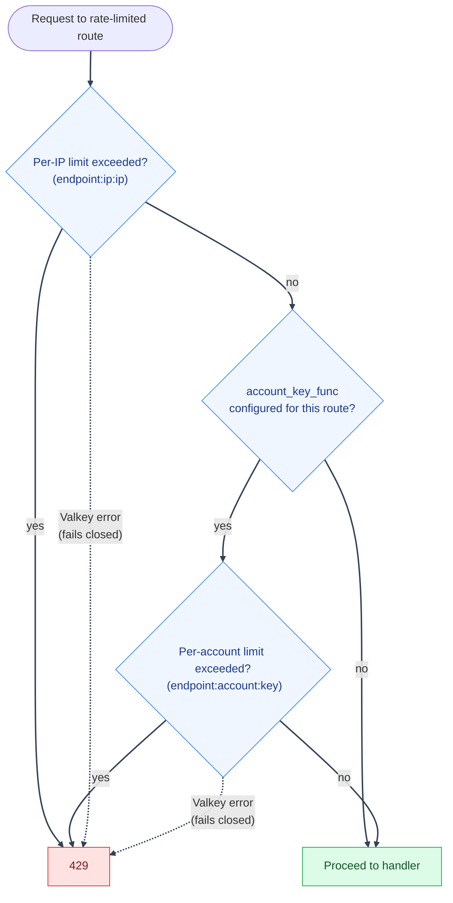
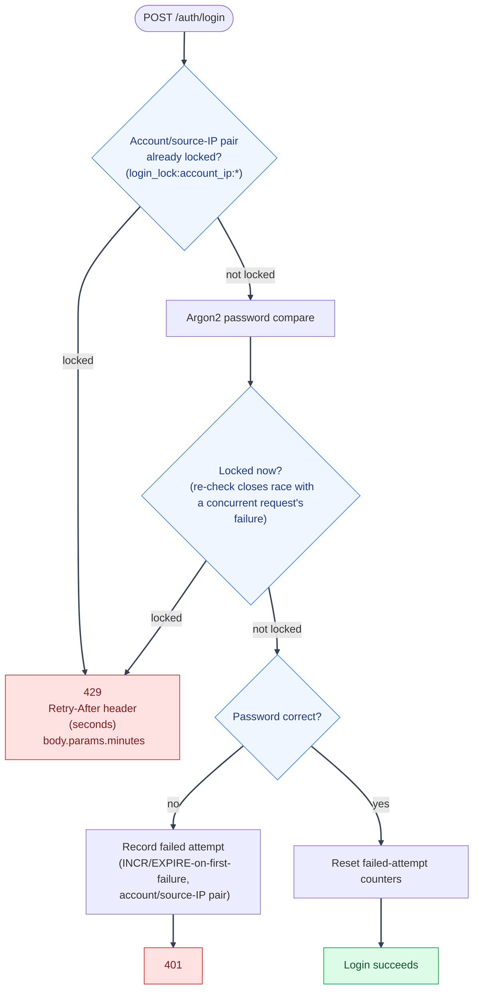

# Security Hardening: Abuse Prevention
---

*New to a term here? See the [Infrastructure Glossary](../glossary/infrastructure.md) or [Authentication Glossary](../glossary/authentication.md).*

Rate limiting, brute-force lockout, and timing-attack resistance: the mechanisms that push back on high-volume or automated abuse at the request layer. See [Security Hardening](hardening.md) for the full index, and [Security Decisions](decisions.md) for the *why* behind non-obvious choices here.

---

## Rate limiting

`backend/mystic_auth/auth/security/rate_limiting/rate_limiter_service.py`: a generic sliding-window-by-fixed-bucket limiter backed by Valkey (`INCR` + `EXPIRE` on first request in a window).

1. Applied via the `@rate_limiter_service.rate_limited("endpoint_name", account_key_func=...)` decorator on every route in `auth_routes.py` and `passkey_routes.py` (passkey sign-in, management, step-up): signup, login, OAuth2 initiate/callback, `/auth/me`, logout, logout-all, password-reset request/confirm, verify-account request/confirm, list/revoke sessions.
2. **Not** applied to `refresh_token_routes.py` (`POST /auth/refresh/`). That route relies instead on its own single-use-token rotation and reuse-detection protection (see [Security Decisions](decisions-auth.md#rate-limiting-and-lockout-are-layered-not-singular)), which a generic request-volume limiter would only duplicate.

---

---

- **Always applies a per-IP limit** (`{endpoint_name}:ip:{ip}`), resolved via [`auth/security/client_ip.py`](../authorization/architecture/component-responsibilities.md#authorization-context-builder) (trusted-proxy-aware).
- **The two OAuth2 routes redirect instead of returning the JSON `429` shown as `R429` above**: `oauth2_login`/`oauth2_callback` pass `rate_limited(..., redirect_url=...)`, so an exceeded limit sends the browser to `/login?error=TOO_MANY_ATTEMPTS` instead - both routes are top-level navigations (they always return a `RedirectResponse`), not API calls with anywhere to render a JSON body. See [Google OAuth2 / PKCE](../authentication/oauth2-pkce.md#edge-cases--error-handling).
- **Optionally applies a per-account limit** when `account_key_func` is given (e.g. signup/password-reset-request key on the submitted email): closes the gap where an attacker spreads requests targeting one account across many source IPs to stay under the per-IP threshold alone.
- Both limits default to `MAX_REQUESTS_PER_WINDOW` / `REQUEST_WINDOW_SECONDS` (`env/mystic_auth/.env.dev.example`). Any route can override just its own threshold instead by passing `rate_limited("endpoint_name", max_requests=..., window_seconds=...)` - give both together (either alone still falls back to the global default for the other). A consuming project can tighten a rarely-hit, sensitive route (e.g. password-reset-request) without touching the shared default every other endpoint keeps using, and `GET /auth/me` (`get_current_user`) does the opposite: it raises its own limit to 300/60s instead of tightening. The shared 100/60s default is sized for `/auth/login`'s brute-force risk, but `/auth/me` is read-only and already session-cookie-gated, and is the highest-frequency authenticated route in the app (the SPA calls it on every route mount). Measured live: a full local run of the 32-account permission-matrix e2e suite tripped the default limit on this endpoint 492 times in one run, misread for months as a WebKit/Firefox cookie-commit timing race, since a rate-limited poll and a genuinely-not-authenticated-yet poll fail with the same symptom. A real user with a few tabs open and normal navigation could plausibly trip the same default. An endpoint that overrides is recorded in `RateLimiterService.ENDPOINT_OVERRIDES` so the [dashboard](#rate-limit-dashboard-get-rate-limits) below reports the threshold it actually enforces, not the global one.
- **Fails closed on Valkey error, reviewed and kept intentionally**:
  1. `record_request` catches all exceptions, logs them, and returns `False` ("not allowed"): a Valkey outage makes every rate-limited request appear over-limit and get rejected with `429`, rather than silently disabling rate limiting.
  2. This is the opposite tradeoff from the PBAC authorization cache, which fails open to the authoritative database on a Valkey error: see [PBAC Troubleshooting: Valkey cache management](../authorization/troubleshooting/valkey-and-logging.md#valkey-cache-management) for that contrast.
  3. Practical implication: a Valkey outage makes the API fully unusable for any rate-limited auth route, not just slower. See [Security Decisions](decisions-auth.md#rate-limiter-fails-closed-on-a-valkey-outage-reviewed-kept-intentionally) for why this was kept rather than changed.
- **`reset_counter` only ever deletes an actual rate-limit key**:
  1. `DELETE /rate-limits/{key}` (see [API Reference](../api/reference.md)) takes the key straight from the URL, but this same Valkey instance also holds unrelated security-critical keys (legacy `revoked:{jti}` markers, password-reset/verify/account-delete tokens, the PBAC policy cache, and more; current replay claims are in Postgres).
  2. `reset_counter` rejects any key that doesn't match the `<endpoint>:<ip|account|email|account_ip>:<identifier>` shape `list_active_limits` itself produces, so this endpoint can never be used to delete something outside the rate-limiter's own keyspace.

---

### Rate Limit Dashboard (`GET /rate-limits/`)

`RateLimitDashboardService.list_active_limits` powers the permission-protected dashboard, and it doesn't only read `RateLimiterService.record_request`'s keys: it `SCAN`s the whole `<endpoint>:<ip|account|email|account_ip>:<identifier>` keyspace, which also picks up [Brute-force lockout](#brute-force-lockout)'s `login_lock:*` keys below (`endpoint` shows as `login_lock` for those rows, and `_effective_limit` reports their `MAX_FAILED_LOGIN_ATTEMPTS_PER_IP` threshold instead of `MAX_REQUESTS_PER_WINDOW`; an endpoint with its own `rate_limited(..., max_requests=...)` override gets its row's `limit` reported from `RateLimiterService.ENDPOINT_OVERRIDES` the same way). So one dashboard, filterable by `scope` (`ip`/`account`/`email`/`account_ip`), covers both mechanisms:

1. An `ip`-scoped row's identifier is always an IP address. This includes generic per-endpoint request limits such as `signup:ip:1.2.3.4`.
2. An `account`- or `email`-scoped row is keyed by an account identifier. The `account_ip` scope is the login failure counter: its identifier is an HMAC digest over the normalized email and source IP, so neither value is exposed in Valkey keys or dashboard rows. It remains resettable from the dashboard.
3. To identify which account and IP were behind a lockout, cross-reference its `login_ip_locked` audit event. The durable [Audit Log](#audit-log-cross-reference) records the attempted email and source IP; the rate-limit key stores neither in clear text.
4. **The matched-key listing is snapshotted for `_SCAN_SNAPSHOT_TTL_SECONDS` (5s)** per filter pattern (`RateLimitDashboardService._scan_snapshot_cache`, an in-process dict, not Valkey), so that paging through one filtered view walks a consistent set of keys instead of two consecutive `SCAN`s disagreeing as counters expire/get created between page requests. `reset_counter` clears this entire snapshot cache on every successful delete, so a caller resetting a counter and immediately re-filtering the dashboard sees the key gone right away, rather than it lingering in the listing (with a correct, live-read count/TTL) for up to 5s until the snapshot naturally expires.

---

## Brute-force lockout

`backend/mystic_auth/auth/security/login_protection_service.py`: separate from and layered on top of the generic rate limiter (see [Security Decisions: rate limiting and lockout are layered](decisions-auth.md#rate-limiting-and-lockout-are-layered-not-singular)):

- Failed-login lockout is keyed by the normalized account/source-IP pair. `MAX_FAILED_LOGIN_ATTEMPTS_PER_IP` failures within `LOGIN_LOCKOUT_TIME_PER_IP` seconds lock only that pair (`login_lock:account_ip:{HMAC(email, client_ip)}`). There is no account-wide failed-attempt counter, so an attacker cannot lock the account for users coming from other IPs. People behind the same VPN/NAT egress have separate failure budgets for different accounts; an attacker using that same egress can still temporarily throttle the same account/IP pair. The generic per-IP request limiter is the aggregate cap across accounts.
- `check_and_record_action`'s failure path is a single atomic Valkey `INCR`, not a separate `is_locked`-then-record pair. A check-then-increment version would let concurrent failures against the same key both read "not yet locked" before either incremented, letting more than `max_attempts` through as `401` under a real burst; the atomic `INCR` closes that race (`test_login_lockout_race_integration.py`).
- The pair counter uses `INCR`/`EXPIRE`-on-first-failure (not sliding), so the lockout window is fixed from the *first* failure, not extended by each subsequent one. The env setting names retain `_PER_IP` for compatibility, but their threshold and expiry apply to the account/IP pair.
- Passkey sign-in failures lock per source IP (`login_lock:ip:{HMAC("passkey", client_ip)}`) and failed step-up confirmations per account and IP (`login_lock:account_ip:{HMAC("stepup", email, client_ip)}`), both using the `_PER_IP` settings, so they show up in the dashboard like password lockouts. See [Passkeys](../authentication/passkeys.md).
- The active key is visible and resettable from the [Rate Limit Dashboard](#rate-limit-dashboard-get-rate-limits) above, under endpoint `login_lock` - there's no separate lockout-specific view.
- The `429` a lockout returns tells the caller how long to actually wait, read straight from the tripped key's remaining Valkey TTL (`get_remaining_seconds`): a standard `Retry-After` header (RFC 9110) plus `params.minutes` (rounded up) in the JSON body for the login form's own translated message. See [Login](../authentication/login.md) for the full response shape.

---

---

### Audit Log cross-reference

1. The rate limiter and lockout counters are ephemeral (Valkey `TTL`-expired). The login `account_ip` key stores only an HMAC digest, not raw email or IP.
2. For a durable, per-event history that does include `ip_address` (e.g. "which IPs hit this account's failed logins"), use the Audit Log instead: `backend/mystic_auth/audit_log/`, `GET /audit/security-log`, filterable by `ip_address` (see [API Reference](../api/reference.md)).
3. It's a separate Postgres-backed record of individual events, not a live counter.

---

### Per-account cool-down across all sources

The lockout above counts failures per account **and** source IP, so guessing spread over many addresses never trips it. A second counter (`auth/security/account_cooldown_service.py`) counts failed logins for one account from every source. After `LOGIN_ACCOUNT_FAILURE_THRESHOLD` (20) failures inside `LOGIN_ACCOUNT_FAILURE_WINDOW_SECONDS` (15 minutes) the account is in a **cool-down**: it accepts one login attempt per `LOGIN_ACCOUNT_COOLDOWN_SECONDS` (30), and other attempts get `429` with `Retry-After`.

It is a cool-down, not a lock, on purpose. A hard lock would let anyone shut the real owner out by guessing wrong passwords on purpose. With a cool-down the attacker is held to about two guesses a minute, while the owner signs in after at most 30 seconds, and a successful sign-in clears the count. Crossing the threshold writes a `login_account_cooldown` audit event and sends one alert. Failed attempts are counted by the submitted email whether or not the account exists, so the behaviour reveals nothing about which accounts exist.

**IPv6:** all per-source counters (rate limits, login lockouts, refresh lockouts) group an IPv6 address by its `/64` prefix, because one customer normally controls the whole `/64` and could otherwise rotate through addresses without ever reaching a limit. In the Rate Limits page such a row shows as `v6-2001-0db8-aaaa-bbbb`.

## Password Unicode normalization

Passwords are NFKC-normalized (NIST SP 800-63B) before they are hashed or checked, in `password_service.normalize_password`. The same typed password then works however a device composes accented or full-width characters, for example "é" as one character or as "e" plus a combining accent. Hashes made before this change were computed on the text exactly as typed, so a normalization-changed input is also checked against the raw form. Ordinary ASCII passwords still cost one Argon2 check.

## Timing-attack resistance

See [Security Decisions: timing-attack mitigations](decisions-auth.md#timing-attack-mitigations): applied at login (dummy-hash comparison), signup (unconditional hashing), and password-reset-request (identical generic response).

---

## No email addresses in Valkey key names

Key names show up in `SCAN`, dumps, backups and monitoring tools, so no account email appears in one. Rate-limit account counters, lockout counters, the authorization cache and the session-event channels use `email_key_id(email)` (`backend/mystic_auth/valkey/key_names.py`), an HMAC of the lower-cased address under `SECRET_KEY`. Emailed one-time tokens (verify, account deletion) are keyed by their SHA-256. The stored key stays hashed, but the Rate Limits page still shows who a counter belongs to: the server recomputes the id for known accounts (and, for `account_ip` lockout counters, for the email and IP of failed attempts in the last 24 hours of the security audit log) and returns the match as `identifier_label` in the response only (`auth/security/rate_limiting/rate_limit_identifier_labels.py`). A counter that matches nobody shows a shortened id with the full value on hover. Anyone with `rate_limits:read` therefore sees the emails of accounts that have live counters, as they did before the ids were hashed. Searching the identifier filter with a full address still finds an account counter, but not an `account_ip` one, which also needs the source IP. Rotating `SECRET_KEY` changes every id, which only resets these short-lived counters and caches.

## Password hashing is bounded

Every sign-in, sign-up and password change runs Argon2, which costs about 0.4 CPU-seconds. A container with 2 CPUs therefore sustains only about 4 to 5 of them per second, however they arrive. Without a bound, a burst queues behind that limit and callers wait until their client gives up (30 seconds in the load test).

Each worker now runs at most `PASSWORD_HASH_CONCURRENCY` hashes at once (default 1) and lets at most `PASSWORD_HASH_MAX_WAITING` more wait (default 2). Anyone beyond that gets `503 SERVICE_UNAVAILABLE` with `Retry-After: 5` straight away, the same answer used for a store outage. The refused request is not counted as a failed sign-in, a sign-up is not reported as successful, and a password-reset link that was consumed is put back. The rest of the API stays responsive while this happens.

Measured on the 2-CPU local stack with 200 sign-in attempts across fresh accounts at 60 at a time: before the bound, the slowest request took 28 seconds; after, 6 seconds, with the excess refused. Capacity is unchanged, because the CPU cost per hash is the same. To serve more sign-ins per second, give the backend more CPUs.
