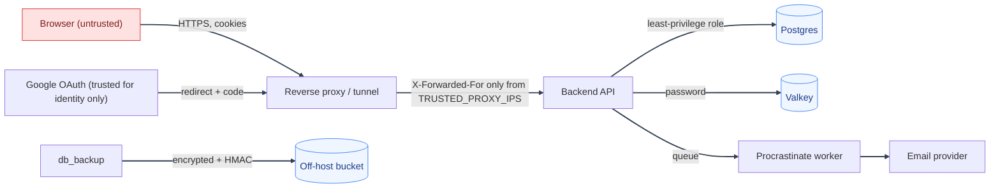

# Threat Model
---

*New to a term here? See the [Authentication Glossary](../glossary/authentication.md) or [Infrastructure Glossary](../glossary/infrastructure.md).*

A short threat model for MysticAuth: what it protects, who might attack it, where the trust boundaries are, and which control answers each threat. It uses the STRIDE categories (Spoofing, Tampering, Repudiation, Information disclosure, Denial of service, Elevation of privilege). Review it whenever a new sign-in method, a new data store, or a new public route is added.

This is a design-level document written from the code and docs. It is not a penetration test result. Controls named here link to the page that explains them.

---

## What we protect

| Asset | Why it matters |
|---|---|
| Password hashes (Argon2id) | Offline cracking if the database leaks |
| Sessions and tokens (access, refresh) | Taking one is taking the account |
| Passkey public keys and credential ids | Low value alone, but they decide who can sign in |
| Policies and permission grants | Changing them changes who can do what |
| The security audit log | The evidence trail after an incident |
| Email, name and profile data | Personal data, plus the verification and reset channel |
| Secrets (`SECRET_KEY`, database passwords, backup key, OAuth client secret) | Forging tokens, reading or restoring data |
| Backups | A full copy of everything above |

---

## Who we defend against

| Actor | Can do | Cannot do |
|---|---|---|
| Anonymous internet user | Hit public routes, guess passwords, try signup and reset flows, send crafted input | Reach Postgres or Valkey directly |
| Authenticated ordinary user | Use their own account, try to reach other accounts or higher permissions | Grant themselves permissions they do not hold |
| Holder of a narrow permission (for example `policies:create`) | Use that permission | Mint or assign anything they do not already hold |
| Attacker with a stolen session or refresh token | Act as the user until it is revoked | Re-use a rotated refresh token without it being detected |
| Phisher | Trick a user into typing a password | Use a passkey on a fake site |
| Compromised dependency | Run code inside the backend or frontend | Be assumed away: this is why CI scans dependencies |
| Operator mistake | Misconfigure CORS, proxies, secrets | Be fully prevented; checks exist but a human still deploys |

Out of scope: an attacker with root on the host, a compromised database superuser, and a compromised identity provider (Google).

---

## Trust boundaries

Everything from the browser is untrusted, including cookies, headers, the `Origin`, and any client-side check. The frontend only hides what the user may not do. The backend decides.

---

## Threats and controls

### Spoofing (pretending to be someone)

| Threat | Control |
|---|---|
| Password guessing and credential stuffing | Per-IP and per-account rate limits, source-scoped lockout, Argon2id, see [Abuse prevention](hardening-abuse-prevention.md) |
| Learning which emails are registered | Generic responses, signup always returns the same body, dummy-hash timing, see [Timing-attack resistance](hardening-abuse-prevention.md#timing-attack-resistance) |
| Stolen session cookie | `HttpOnly`, `Secure`, `SameSite=Strict`, short access token, rotating single-use refresh token with reuse detection, per-session revoke and sign out everywhere |
| Phishing | Optional passkeys are bound to the site, so a fake site cannot use them |
| Forged tokens | Signed JWTs with pinned algorithm, issuer and audience, `SECRET_KEY` strength enforced at start-up |
| Fake OAuth callback | `oauth_state` cookie and PKCE, see [OAuth2 PKCE](../authentication/oauth2-pkce.md) |
| Spoofed client IP | `X-Forwarded-For` trusted only from `TRUSTED_PROXY_IPS`, see [Reverse-proxy IP trust](hardening-infra.md#reverse-proxy-ip-trust) |

### Tampering (changing data)

| Threat | Control |
|---|---|
| SQL injection | SQLAlchemy parameterised queries, Pydantic schemas on every route |
| Cross-site request forgery | `SameSite=Strict` cookies, restricted CORS to the configured origins, JSON-only bodies |
| Editing the audit trail | The application database role has `UPDATE` and `DELETE` on the audit log revoked |
| Tampering with a backup | Detached HMAC-SHA256 tag checked before restore, see [Database backup](../database/design.md) |
| A caller widening their own permissions | `assert_authorized_to_grant` blocks granting anything the caller does not hold, with mutation-checked tests |
| Replaying a one-time link | Verification, reset and deletion tokens are single use and expire |

### Repudiation (denying an action)

| Threat | Control |
|---|---|
| "I never did that" | Security audit log for sign-in, logout, passkey, role, policy and lifecycle events, with IP, user agent and request id |
| Operator actions on another account | Audited with the acting user, for example `removed_by` on operator passkey removal |
| Silent credential changes | The account holder is emailed when a passkey is added or removed |

### Information disclosure (leaking data)

| Threat | Control |
|---|---|
| Stack traces or internals in errors | Global handler returns a generic 500, `debug` is never enabled |
| Secrets in logs or URLs | No secrets in the audit log, email links carry tokens in the URL fragment, `Referrer-Policy: no-referrer` |
| Cached sensitive responses | `Cache-Control: no-store` on every API response |
| Leaked database dump | Passwords are hashed; backups are encrypted |
| Cross-origin reads | CORP, COOP, COEP and strict CSP, see [HTTP layer](hardening-http.md) |
| Cross-site scripting | React escaping, `html.escape` in emails, CSP without inline script or style allowances |
| Leaked repository secrets | `gitleaks` over full history in CI |

### Denial of service (making it unavailable)

| Threat | Control |
|---|---|
| Request floods against auth routes | Layered rate limits and lockout |
| One attacker locking out a victim | Lockout is scoped to the account and source IP pair, not account-wide |
| Expensive hashing used as a weapon | Rate limits sit in front of Argon2; passwords are capped at 128 characters |
| Valkey outage | Rate limiting fails closed by design; this trades availability for safety, an accepted decision |
| Oversized or malformed requests | Pydantic length caps, nginx header and URI limits |

### Elevation of privilege (gaining more access)

| Threat | Control |
|---|---|
| Missing authorization on a route | Deny by default, `require_authorization` on each route |
| Acting on a more privileged account | `users:manage_privileged` required when the target holds the admin role; the system account is untouchable through generic routes |
| Using a narrow permission to reach a broad one | Grant guard, policy history rollback checks, resource-type repointing checks |
| Over-privileged database access | Application connects with a least-privilege role, tested in `test_least_privilege_db_role.py` |
| Compromised dependency | `pip-audit`, `npm audit`, `trivy`, SBOM, manual batched upgrades |

---

## Residual risks we accept

These are decisions, not oversights. Open ones are tracked on the [Concerns](../concerns/README.md) page.

- No multi-factor authentication, by choice. Password or Google sign-in is the main path, and optional passkeys are offered instead of a forced second factor.
- Password rules are 8 characters with upper, lower and digit, and no breach check.
- Authorization decisions can be up to 60 seconds stale after an out-of-band permission write.
- A thief replaying a refresh token from the same IP and user agent inside the 10-second grace window looks like the real device.
- A Valkey outage stops authentication (fail closed).
- Plus-addressed and Unicode look-alike emails can create separate accounts. Email verification still requires a working mailbox, and a look-alike cannot receive the real person's mail, so this gives no account access. A product that limits things per person (free trials, credits) should add its own control, such as phone or card checks, or a normalised-email duplicate flag.
- No point-in-time database recovery; backups are periodic dumps.
- No TLS between containers on the same host's private network.

## When to update this page

- A new sign-in method, token type, or public route.
- A new place that stores personal data or secrets.
- A change to which proxy or tunnel sits in front of the API.
- After any security incident.

## See also

- [Security Hardening](hardening.md)
- [Security Decisions](decisions.md)
- [ASVS Level 3 mapping](asvs-mapping.md)
- [Concerns](../concerns/README.md)
