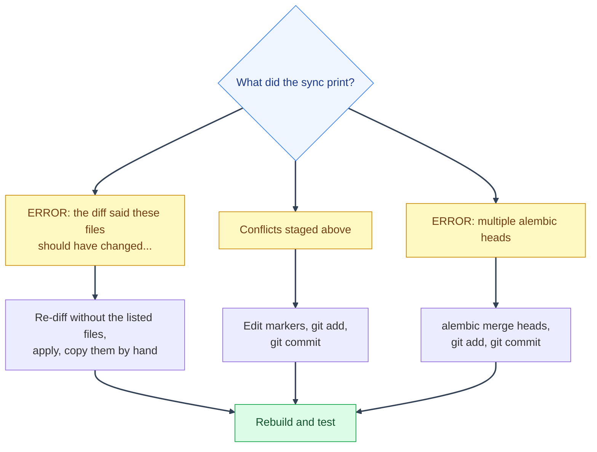

# Syncing Upstream: Troubleshooting

---

Which section to read, by what the script printed:



## If it reports a silent partial apply

Rarely, `git apply`/`git merge` can report a normal result (clean, or an ordinary conflict) while one file in the patch silently fails to apply at all, with nothing in the output distinguishing that from a real success. A changed binary file (a screenshot, an icon) in the middle of an otherwise-large patch is the most common trigger. The script guards against this by comparing the file list the diff says should have changed against what's actually changed/staged/conflicted afterward, and refuses to commit if they don't match:

```
ERROR: the diff said these files should have changed, but none of them show up as changed, staged, or conflicted:
  screenshots/mystic_auth/dashboard.png

This is the 'silent partial apply' failure mode -- ...
Work around it by re-diffing with the listed path(s) excluded (':!path' per file), then applying that instead, e.g. for a single file:
  git diff --binary <sha> upstream/main -- . ':!screenshots/mystic_auth/dashboard.png' | git apply --3way --index -
Then handle the excluded file(s) by hand (e.g. copy the file straight from upstream's working tree).
```

Nothing is committed when this fires. Run the suggested command to apply everything except the problem file(s), then copy the excluded file(s) over by hand (e.g. `git show upstream/main:screenshots/mystic_auth/dashboard.png > screenshots/mystic_auth/dashboard.png`) before committing. Once resolved, run the sync script again to pick up where you left off.

Note: this template's own screenshots live under `screenshots/mystic_auth/`, following the same `app/`/`mystic_auth/` ownership split used everywhere else in the repo (see [the ownership split](../ownership-split.md)). Put your own project's screenshots in `screenshots/app/` instead: since upstream never touches that folder, a sync can never collide with anything you put there, which is what causes this failure mode in the first place.

---

## "The sync tools are not the latest upstream versions"

The script compares its own files (`scripts/mystic_auth/upstream-sync/`) with upstream's and stops if they differ, because an old copy can block or mishandle a sync the latest one handles. Run the command it prints, then run the sync again:

```bash
git restore --source=upstream/main --worktree -- scripts/mystic_auth/upstream-sync/
```

This only changes your working tree. Do not commit it; the sync stages these files together with the rest of the result.

## "An earlier sync in this project is unfinished"

A sync that stopped on conflicts, or a clean one you have not committed yet, leaves staged files behind. Starting another sync on top would mix the two, so the script refuses. Either finish it (resolve, run the checks, commit) or throw it away:

```bash
scripts/mystic_auth/upstream-sync/sync-upstream.sh --abort
```

`--abort` explains exactly what it will undo and what you lose, then waits for you to type `abandon`. It puts back any work the sync saved aside and never touches your other stashes.

## "Already identical to upstream in this project"

The apply step lists files whose contents in your project already match upstream byte for byte (for example because you copied a fix over by hand before syncing). Nothing needs to change for them, so this is not an error.

---

## Step 6: Conflict: resolve it

A "conflict" just means: you had made your own edit to a line, and upstream also changed that same line, so git can't automatically decide which version should win and needs a human (you) to pick. This is most likely in `backend/app/main.py` or `frontend/src/app/App.tsx`, since those are the two files you're expected to routinely edit (registering your own routers/routes), and only if you genuinely edited the exact same lines upstream did. It can also happen, less often, in a shared config file neither side "owns" outright: `frontend/package.json`, `backend/requirements.txt`, `docker/mystic_auth/compose/docker-compose.dev.yml`, `env/mystic_auth/.env.dev.example`, one of the seeded app starter files (`app_sdk.py`, `app_sdk.ts`, `main.tsx`, `theme.ts`, or an `app/` folder's `README.md`; keep your version unless the upstream edit is a fix you need), or one of the downstream-owned `legal.json` content files, if you've edited the exact same line upstream touched (e.g. you'd already bumped the same dependency's version, or added your own dependency on the same line upstream reformatted). For most syncs, none of this happens at all. You'll see something like:

If the conflicted file is `landing.json`, `status_pages.json`, or `legal.json`, retain your reviewed deployment content and merge in any new keys or structural changes from upstream. Review legal wording before publishing it. The exceptions and their exact paths are documented in [the ownership split](../ownership-split.md#one-intentional-content-exception-three-namespaces).

```
Conflicts staged above -- resolve them in your working tree, then:
  git add <resolved files>
  git commit -m "Sync upstream template updates (mystic-auth@<sha>)"
```

To fix it:

1. Open the file it mentions in your editor.
2. Look for blocks marked with `<<<<<<<`, `=======`, and `>>>>>>>`. This is git showing you both versions of the same spot: your version above the `=======`, upstream's version below it.
3. Decide what the combined result should look like. Almost always this means **keeping both** changes, just written one after another. Then delete the `<<<<<<<`/`=======`/`>>>>>>>` marker lines themselves.
4. Save the file, then run the two commands the script printed for you (shown above): `git add <the file>`, then `git commit -m "..."` with the message it suggested.

See [Resolving a conflict in `main.py` / `App.tsx`](rebuild-and-push.md#resolving-a-conflict-in-mainpy--apptsx) for a full worked example with real code, if you want to see one before you hit this for real.

**A recurring shape of conflict you'll hit more than once: upstream rewording its own comments.** If upstream cleans up a comment sitting right next to a line you've customized (in `main.py`/`App.tsx`, most often), that shows up as a conflict on every sync until your side changes too, even though there's no real disagreement, just proximity. The sync script turns on [`git rerere`](https://git-scm.com/docs/git-rerere) (git's built-in "remember how I resolved this last time") the first time you run it. Resolve a conflict like that once, and if the exact same shape of conflict shows up on a later sync, git auto-resolves it for you and just tells you it did (`Resolved 'backend/app/main.py' using previous resolution.`) instead of stopping to ask again. You still get a chance to review it in your diff before committing.

---

## If it reports multiple alembic heads

Separately from a git conflict, the script checks whether this sync just produced two alembic migration heads: this app added its own migration on top of the same upstream commit that upstream *also* added a migration on top of. Nothing about a normal git merge would notice this (both files can land with zero conflicts), but `alembic upgrade head` will refuse to run afterward with `Multiple head revisions are present` until it's fixed. You'll see:

```
ERROR: multiple alembic heads detected (2):

  <revision-a>  <first line of that migration's docstring>
    backend/alembic/versions/<file-a>.py
  <revision-b>  <first line of that migration's docstring>
    backend/alembic/versions/<file-b>.py

...

Not committing -- resolve the alembic branch above first, then:
  git add backend/alembic/versions/<merge migration file>
  git commit -m "Sync upstream template updates (mystic-auth@<sha>)"
```

Fix it the same way you'd fix any two-heads alembic history, with a merge migration. `backend-exec.sh` wraps `docker compose exec`, which needs the `backend` container already up and healthy, so bring the stack up first if you haven't already (e.g. right after a fresh sync, before anything's running):

```bash
docker compose -f docker/mystic_auth/compose/docker-compose.dev.yml -f docker/app/compose/docker-compose.dev.yml --env-file env/mystic_auth/.env.dev --env-file env/app/.env.dev up -d --build
scripts/mystic_auth/docker/dev/backend-exec.sh alembic merge heads -m "merge migration branches"
git add backend/alembic/versions/
git commit -m "Sync upstream template updates (mystic-auth@<sha>)"
```

`docker compose run` looks like the natural alternative when the stack isn't up yet, but don't use it here: the backend image's entrypoint drops root privilege via `su-exec` regardless of `--user root` on `run` (only `exec` against an already-running container respects it), so `alembic merge heads` fails trying to write the new migration file under the bind-mounted, host-owned `backend/alembic/versions/`.

This check also runs standalone any time you want it, without syncing: `scripts/mystic_auth/upstream-sync/check-alembic-heads.sh` (Git Bash/WSL/Linux/macOS), `.\scripts\mystic_auth\upstream-sync\check-alembic-heads.ps1` (PowerShell), or `scripts\mystic_auth\upstream-sync\check-alembic-heads.cmd` (Command Prompt). These use the same "locate Git Bash, run the real script" wrapper as `sync-upstream.ps1`/`.cmd`.

---

See [Syncing Upstream](README.md) for the earlier steps, or [Rebuild, Push, and Reference](rebuild-and-push.md) for what comes after a clean sync or a resolved conflict.

---
